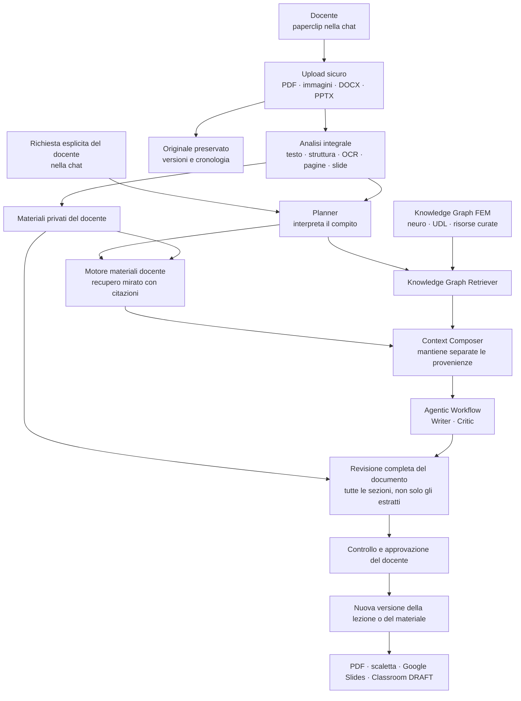

# Strategia AI — Evoluzione del paperclip ed export integrati

**Versione:** 1.1  
**Data:** 2026-08-09  
**Destinatari:** CEO e Direzione FEM  
**Responsabili proposti:** Team AI —  Louis/Angelo  
**Stato:** proposta strategica  

---

## 1. Sintesi esecutiva

La proposta risponde a due esigenze:

1. usare il **paperclip già presente nella chat** per caricare PDF, immagini, documenti e presentazioni, così da analizzare, revisionare e aggiornare materiali didattici esistenti;
2. permettere il download in PDF o scaletta testuale e la creazione di risorse modificabili in Google Slides e Google Classroom.

La raccomandazione non è costruire una nuova applicazione documentale. È **evolvere il paperclip della WebUI con un servizio backend sicuro e versionato**, integrato con l'Agentic GraphRAG attuale.

I materiali del docente rimangono privati e separati dal Knowledge Graph condiviso. Al momento della generazione, l'agente combina:

- il contenuto e i vincoli dei materiali caricati;
- la conoscenza neuro/UDL e le risorse curate del Knowledge Graph;
- la richiesta esplicita del docente nella chat.

Questa separazione permette di aggiungere le nuove capacità senza compromettere ciò che AixLearning fa già bene e senza riscrivere i flussi esistenti.

I Punti 3 e 4 — Dominio Instructional e use case verticali — sono approfonditi nell’Appendice A; i Punti 5 e 6 — convergenza con AI for Learning e percorso Corporate — nell’Appendice B.

---


## 2. Architettura in una pagina

La figura mostra come il paperclip della chat diventa il punto di ingresso dell'intero processo.

**Architettura target proposta**




### Principio centrale

> I materiali privati e il Knowledge Graph collaborano nella risposta, ma rimangono separati per proteggere qualità, privacy, proprietà e possibilità di cancellazione.

---


## 3. Punto 1 — Gestione avanzata degli input


### 3.1 Il punto di ingresso resta il paperclip della chat

Il docente continuerà a lavorare nella stessa conversazione. Dal paperclip potrà allegare:

- PDF digitali o scansiti;
- immagini;
- DOCX;
- PPTX;
- file testuali già supportati.

La WebUI mostrerà:

- stato dell'elaborazione;
- anteprima;
- numero di pagine o slide;
- eventuali problemi di lettura;
- versioni disponibili;
- download dell'originale e della versione aggiornata.

Non è previsto un nuovo prodotto separato: il servizio documentale opera dietro l'interfaccia esistente.

### 3.2 Il documento viene analizzato integralmente

Il file caricato viene realmente utilizzato, non soltanto archiviato.

L'intero documento viene acquisito e analizzato una volta per ogni versione, conservando:

- testo;
- struttura;
- ordine delle sezioni;
- pagine o slide;
- tabelle e immagini;
- riferimenti alle fonti;
- collegamento con il file originale.

L'uso successivo dipende dal compito:

1. **Domanda o modifica mirata**
  L'agente recupera le sezioni pertinenti con pagina o slide e citazione.
2. **Revisione completa**
  Il sistema attraversa tutte le sezioni, verifica coerenza e vincoli, propone le modifiche e ricompone il risultato finale.
3. **Documento breve**
  Se dimensione e policy lo consentono, può essere utilizzato integralmente nel contesto AI.
4. **Documento esteso o complesso**
  Viene elaborato per sezioni in modo controllato, evitando di reinviare inutilmente il file grezzo a ogni chiamata.

Questa strategia usa l'intero materiale, ma riduce costi, perdita di contesto e rischi tipici del semplice “copia tutto nel prompt”.

### 3.3 Materiali privati e Knowledge Graph

Il motore dei materiali del docente, tecnicamente `PrivateMaterialRetriever`, cerca esclusivamente nei file autorizzati dell'utente e restituisce:

- frammenti pertinenti;
- pagina o slide;
- versione;
- citazione;
- provenienza.

Il `KnowledgeGraphRetriever` continua invece a recuperare:

- concetti neuro/UDL;
- metodologie curate;
- relazioni ed evidenze condivise;
- risorse globali.

Esempio:

> “Aggiorna questa mia vecchia lezione mantenendo durata e attività, ma migliorandola secondo UDL.”

Il sistema usa:

- la vecchia lezione per struttura, durata e vincoli;
- il Knowledge Graph per principi UDL e metodologie;
- Writer e Critic per produrre e controllare la nuova versione;
- le citazioni per mostrare l'origine delle informazioni.

Il materiale privato non viene inserito nel Knowledge Graph globale e non diventa visibile ad altri utenti.

### 3.4 Preservazione della qualità

Il sistema non sovrascrive mai il file originale.

Ogni aggiornamento prevede:

- proposta di modifica;
- confronto con la versione precedente;
- approvazione del docente;
- nuova versione scaricabile;
- provenienza e cronologia.

“Senza perdere qualità” significa preservare struttura e layout quando il formato lo consente e dichiarare chiaramente quando viene generata una nuova versione.

Non è tecnicamente corretto promettere modifica pixel-perfect di qualsiasi PDF o presentazione. SmartArt, animazioni, macro e oggetti proprietari richiedono limiti espliciti e test sui materiali reali FEM.

### 3.5 Sicurezza nell'uso degli allegati

Una lezione precedente o una ricerca del docente può essere una fonte autorevole e deve essere trattata come tale.

Per sicurezza, eventuali istruzioni contenute nel file non possono però:

- modificare le regole dell'agente;
- attivare strumenti;
- accedere ad altri file;
- pubblicare o inviare dati.

Queste azioni richiedono sempre una richiesta esplicita del docente nella chat e, dove necessario, una conferma.

La protezione riguarda il comportamento del sistema, non il valore pedagogico del documento.

---


## 4. Punto 2 — Export e integrazione Google

AixLearning offre già il download in Markdown e TXT e una funzione di stampa per il salvataggio PDF. La proposta non sostituisce queste capacità: le consolida e le estende con PDF diretto, scaletta semantica, integrazione delle risorse multimediali e pubblicazione controllata verso Google Slides e Classroom.

### 4.1 Un contenuto coerente, più destinazioni

La lezione viene organizzata in una struttura comune dalla quale derivano:

```text
Lezione strutturata
  ├─ Markdown e TXT esistenti
  ├─ PDF
  ├─ scaletta testuale
  ├─ Google Slides
  └─ Google Classroom
```

In questo modo tutte le destinazioni ricevono lo stesso contenuto, senza conversioni indipendenti che potrebbero produrre risultati incoerenti.

### 4.2 PDF e scaletta

Il sistema aggiungerà:

- un vero PDF scaricabile;
- paginazione e link;
- fonti e attribuzioni;
- indicazione della generazione AI;
- una scaletta con obiettivi, tempi, attività, valutazione e risorse.

Markdown, TXT e la stampa browser attuali resteranno disponibili.

### 4.3 Google Slides

Il sistema:

1. usa un template FEM versionato;
2. crea una copia nel Drive del docente;
3. trasforma la lezione in slide leggibili;
4. gestisce automaticamente il testo troppo lungo;
5. inserisce link, video e risorse consentite;
6. restituisce una presentazione modificabile.

La creazione avviene tramite API ufficiali Google e operazioni idempotenti, evitando duplicati in caso di timeout.

### 4.4 Google Classroom

Il docente sceglie il corso e le risorse da allegare.

La prima versione crea sempre un materiale in stato di **bozza** (`DRAFT`), così il docente può:

- controllare Slides, PDF, link e video;
- modificare la descrizione;
- decidere quando pubblicare.

Non sono previste pubblicazioni automatiche agli studenti.

### 4.5 Licenze

Una risorsa verificata pedagogicamente non è automaticamente copiabile.

La policy proposta è:

- YouTube: embed o link;
- paper e pagine web: citazione/link;
- immagini OER: copia solo con licenza compatibile;
- licenza sconosciuta: link-only;
- allegati privati: mai pubblicati automaticamente;
- selezione finale delle risorse: confermata dal docente.

---


## 5. Scelte tecnologiche essenziali


### Componenti esistenti da mantenere

- FastAPI e htmx per WebUI e API;
- LangGraph per l'orchestrazione agentica;
- Neo4j/GraphRAG per la conoscenza condivisa;
- PostgreSQL per dati applicativi;
- pipeline e route esistenti.


### Componenti da aggiungere

- storage S3-compatible per originali e versioni;
- worker asincrono per OCR, analisi ed export;
- Docling e parser specializzati per i diversi formati;
- `pgvector` per la ricerca nei materiali privati;
- ReportLab per il PDF;
- API ufficiali Google Drive, Slides e Classroom;
- migrazioni database versionate e feature flag.


### Perché pgvector nella prima fase

`pgvector` è sufficiente per il pilot, riusa PostgreSQL e integra bene proprietà, autorizzazioni e cancellazione.

Qdrant resta un'opzione futura se il volume o il traffico richiederanno un motore vettoriale indipendente. L'accesso ai vettori sarà comunque isolato dietro un'interfaccia, evitando lock-in.

---


## 6. Efficienza e compatibilità

La migrazione sarà additiva:

1. **Legacy** — con le nuove funzioni disabilitate, tutto funziona come oggi.
2. **Shadow** — la nuova pipeline analizza i file senza modificare l'output utente.
3. **Hybrid** — il nuovo motore viene usato quando pronto, con fallback al percorso attuale.
4. **Advanced** — dopo la validazione, le nuove capacità diventano il default.

Restano inizialmente invariati:

- paperclip e conversazione;
- `teacher_provided_context`;
- Writer e pipeline attuale;
- Markdown/TXT e stampa browser;
- API e integrazioni esistenti.

Feature flag server-side consentono di abilitare o disabilitare separatamente:

- nuovi formati e OCR;
- ricerca nei materiali privati;
- revisione;
- PDF e scaletta;
- Slides;
- Classroom.

Questa strategia evita una sostituzione “big bang” e consente rollback senza perdere le lesson o interrompere il GraphRAG.

---


## 7. Roadmap proposta


### Fase 0 — Fondazioni

Persistenza sicura, versioni, worker, migrazioni e controlli di accesso.

### Fase 1 — Input avanzati

PDF, immagini, DOCX, PPTX, OCR, preview, ricerca privata e citazioni.

### Fase 2 — Export locale

PDF reale, scaletta e modello comune della lezione.

### Fase 3 — Google

Account Google, Slides, Classroom in bozza e pilot interno FEM.

### Fase 4 — Revisione avanzata

Modifiche controllate di DOCX/PPTX, confronto, approvazione e quality gate.

Le Fasi 1 e 2 possono procedere in parallelo dopo le fondazioni.

---


## 8. Benefici e controllo dei rischi


### Benefici

- riuso dei materiali già prodotti;
- meno copia/incolla;
- fonti e versioni tracciabili;
- output modificabili;
- Knowledge Graph preservato;
- base riutilizzabile per futuri formati e LMS;
- rollout senza riscrittura distruttiva.


### Rischi controllati

- **Fedeltà:** originale immutabile, preview e quality gate.
- **Privacy:** materiali privati separati e accesso autorizzato.
- **Sicurezza AI:** il contenuto non può attivare azioni.
- **Duplicati Google:** operazioni idempotenti e riconciliazione.
- **Licenze:** copia solo quando consentita; altrimenti link.
- **Regressioni:** shadow mode, feature flag e fallback legacy.

---


## 9. Decisioni richieste alla Direzione

1. Il pilot deve includere Slides soltanto oppure anche Classroom?
2. Quali formati e materiali reali FEM hanno priorità?
3. La prima release deve offrire revisione assistita o modifica avanzata dei sorgenti?
4. Quali materiali possono essere elaborati da provider esterni?
5. Il rollout Google resta inizialmente limitato agli account `fem.digital`?

È necessario raccogliere un piccolo corpus rappresentativo di PDF, immagini, DOCX e PPTX FEM per definire e misurare la qualità attesa.

---


## 10. Indicatori di successo

Il pilot dovrà dimostrare:

- nessuna regressione dei flussi attuali;
- nessuna perdita degli originali;
- nessun accesso tra utenti;
- citazioni corrette a pagina o slide;
- qualità utile sul corpus FEM concordato;
- riduzione del lavoro manuale;
- PDF e Slides coerenti con la lesson;
- nessun duplicato Google;
- nessuna pubblicazione non approvata;
- feedback positivo dei docenti pilota.

---


## 11. Conclusione

La raccomandazione è evolvere il paperclip della chat con un servizio backend sicuro e versionato, integrato con l'Agentic GraphRAG esistente.

Il docente continua a usare la stessa WebUI. Dietro il paperclip, AixLearning acquisisce integralmente il materiale, ne preserva l'originale, combina le informazioni pertinenti con il Knowledge Graph e produce revisioni o export controllati.

Questa soluzione permette di aggiungere PDF, outline, Google Slides e Classroom mantenendo:

- qualità del GraphRAG;
- privacy dei materiali;
- controllo del docente;
- compatibilità con il prodotto attuale;
- possibilità di crescita futura.

---


## Appendice A — Priorità 2: dominio Instructional e use case verticali

Questa appendice tratta due linee successive:

3. integrazione del dominio Instructional e ottimizzazione dei follow-up graph-powered;
4. definizione e test di 1–2 use case verticali.

Sono classificate come **seconda priorità** perché dipendono da decisioni semantiche e pedagogiche che il Team AI non può assumere autonomamente. I punti 1 e 2 del documento possono invece iniziare sulla base di requisiti tecnici già sufficientemente definiti.

I seguenti elementi servono a orientare il ragionamento. La decisione finale sulle definizioni e sugli obiettivi del dominio Instructional, così come sulla definizione dei use case, spetta ai domain expert. Il Team AI supporterà il processo e metterà a disposizione la struttura per la raccolta e il trattamento dei dati già utilizzata per i domini Neuro e UDL e nel lavoro in corso su GBL.

### A.1 Risultato dell'indagine

Il dominio Instructional non parte da zero:

- il grafo UDL contiene già strategie e tecniche didattiche;
- sono presenti strumenti digitali e barriere tecnologiche;
- esistono risultati di apprendimento osservabili;
- il grafo include una prima rappresentazione della tassonomia di Bloom;
- la WebUI raccoglie già l'intento pedagogico del docente;
- Planner distingue già differenti intenti della richiesta.

Questi elementi rimangono però frammentati. Non esiste ancora un modello condiviso che colleghi formalmente:

```text
intento del docente
  → obiettivo o competenza
  → attività didattica
  → evidenza di apprendimento
  → valutazione
  → strategie UDL
  → meccanismi neuro
```

Non esiste inoltre un grafo curricolare completo. Il tool previsto per obiettivi e standard ufficiali è ancora un placeholder.

Conclusione: “caricare un dominio Instructional” non è una semplice operazione di importazione. Prima occorre definire che cosa sia il dominio, che problema debba risolvere e come evitare duplicazioni con UDL e Neuro.

### A.2 Possibili significati di “dominio Instructional”

Il termine può indicare almeno quattro cose diverse:

1. **Curricolo e competenze**
  Obiettivi ufficiali, competenze, livelli scolastici, materie e criteri di valutazione.
2. **Instructional design**
  Obiettivi osservabili, sequenze, attività, assessment, prerequisiti e strategie.
3. **Livello di collegamento**
  Un ponte tra intenzione del docente, obiettivi/competenze e strategie UDL/Neuro.
4. **Conoscenza disciplinare**
  Contenuti di matematica, scienze, storia e altre materie.

La quarta interpretazione cambierebbe in modo sostanziale l'attuale perimetro del prodotto, che utilizza il KG soprattutto per il “come insegnare” e fonti esterne per il “cosa insegnare”.

L'ipotesi architetturale più coerente con AixLearning è la combinazione dei primi tre significati, con il dominio Instructional come **livello semantico di collegamento**, non come terzo grafo isolato e duplicato.

Questa rimane un'ipotesi: la decisione finale spetta alla discovery con gli esperti.

### A.3 Opzioni architetturali da valutare dopo la discovery


#### Opzione 1 — Terzo dominio separato

Un nuovo dominio `instructional` parallelo a `neuro` e `udl`.

Vantaggio: segue il pattern tecnico esistente.  
Rischio: duplica strategie e obiettivi già presenti in UDL e rende più complessa la ricerca tra domini.

#### Opzione 2 — Livello semantico di collegamento

Nuovi nodi per intenti, competenze, obiettivi e criteri di valutazione, collegati ai domini esistenti.

Esempio:

```text
LearningObjective
  ├─ ALIGNS_WITH → Competency
  ├─ EVIDENCED_BY → AssessmentCriterion
  ├─ SUPPORTED_BY → UDLStrategy
  └─ ENGAGES → NeuroCognitiveProcess
```

Vantaggio: riusa il patrimonio esistente e rende possibili percorsi spiegabili.  
Rischio: richiede nuove query multi-dominio e regole rigorose per le relazioni.

#### Opzione 3 — Estensione del dominio UDL

Competenze e obiettivi vengono aggiunti direttamente a UDL.

Vantaggio: minore lavoro iniziale.  
Rischio: confonde UDL, curricolo e instructional design in un unico dominio.

La raccomandazione preliminare è **Opzione 2**, da confermare solo dopo aver definito casi d'uso, tassonomia e governance.

### A.4 Input necessari da Dana e Laura

Prima della proposta architetturale definitiva, gli esperti di dominio devono produrre:

1. **Definizione e confini**
  - cosa è Instructional;
  - cosa appartiene invece a UDL, Neuro o contenuto disciplinare;
  - quali decisioni deve supportare.
2. **Tassonomia**
  - intenti pedagogici;
  - obiettivi e competenze;
  - attività;
  - evidenze e assessment;
  - prerequisiti e progressioni.
3. **Relazioni**
  - quali collegamenti sono pedagogicamente validi;
  - direzione e significato delle relazioni;
  - esempi e controesempi.
4. **Autorità delle fonti**
  - riferimenti ministeriali o istituzionali;
  - evidenze scientifiche;
  - criteri di inclusione e aggiornamento;
  - provenienza e versionamento.
5. **Rubriche**
  - proprietà di una risposta accettabile;
  - errori gravi;
  - raccomandazioni vietate;
  - casi nei quali il sistema deve chiedere chiarimenti.
6. **Governance**
  - chi approva nodi e relazioni;
  - come si gestiscono conflitti;
  - come vengono deprecate informazioni superate.

1EdTech CASE può essere valutato come riferimento tecnico per identificare obiettivi e competenze. CAST UDL 3.0 resta il riferimento per la progettazione inclusiva. Questi standard non sostituiscono però le scelte pedagogiche FEM.

### A.5 Follow-up graph-powered: situazione attuale

Il follow-up oggi non utilizza soltanto il normale contesto LLM.

Ogni nuovo turno:

1. recupera la conversazione precedente;
2. rilancia Planner;
3. genera nuove query;
4. interroga nuovamente il Knowledge Graph;
5. riscrive la lezione;
6. la sottopone al Critic.

Il grafo è quindi già coinvolto. Il limite è che quasi ogni follow-up viene trattato come una nuova generazione completa:

- non distingue bene tra domanda e modifica;
- non riusa in modo strutturato le evidenze precedenti;
- non esegue retrieval incrementale;
- non conserva ancora citazioni legate ai singoli blocchi;
- una domanda breve può causare la riscrittura dell'intera lesson;
- il contesto storico può influenzare impropriamente le nuove query.

L'obiettivo corretto non è “aggiungere il GraphRAG ai follow-up”, ma rendere i follow-up **intenzionali, selettivi e citabili**.

### A.6 Strategia per i follow-up

Introdurre un router che distingua:

- `STYLE_REFINE` — semplifica o cambia tono, riusando le evidenze;
- `PROFILE_ADAPT` — adatta a un nuovo profilo, cercando solo i nuovi supporti;
- `CONTENT_EXTEND` — aggiunge attività o parti con retrieval incrementale;
- `TOPIC_PIVOT` — cambia argomento e rilancia il flusso completo;
- `GRAPH_QA` — risponde a una domanda pedagogica breve con citazioni;
- `CLARIFY` — chiede un dettaglio prima di agire.

```text
Nuovo messaggio
  → FollowUp Router
      ├─ riuso evidenze
      ├─ retrieval incrementale
      ├─ retrieval completo
      ├─ risposta KG breve
      └─ domanda di chiarimento
```

Il Team Tech può prototipare il router generico usando i domini attuali. Le regole instructional, le domande suggerite e i percorsi specifici restano bloccati fino alla definizione del dominio e dei use case.

### A.7 Use case verticale candidato 1 — Accessibilità e fattibilità

**Domanda:** una tecnologia o attività è adatta a questo profilo di classe e alle dotazioni disponibili?

Input:

- profilo aggregato della classe;
- BES rilevanti;
- WiFi, LIM, dispositivi e software;
- obiettivo didattico;
- tecnologia o attività proposta.

Output atteso:

- `adatta`;
- `adatta con condizioni`;
- `non consigliata`;
- adattamenti necessari;
- alternativa accessibile;
- motivazione e fonti.

Il test deve verificare che il GraphRAG cambi realmente la proposta quando cambiano le condizioni. Per esempio:

- `own_device=NO` deve escludere attività che richiedono smartphone individuali;
- `has_wifi=false` deve eliminare dipendenze dalla rete;
- un profilo con barriera visiva deve richiedere alternative accessibili;
- la rimozione della barriera deve produrre un risultato differente ma coerente.

WCAG 2.2 e gli standard tecnici di accessibilità possono supportare il controllo dei contenuti digitali, ma non determinano da soli l'appropriatezza didattica per uno specifico profilo. Sono indispensabili regole approvate dagli esperti.

### A.8 Use case verticale candidato 2 — Allineamento instructional

**Domanda:** obiettivi, attività e valutazione sono realmente allineati e adatti alla classe?

Input:

- intento pedagogico;
- materia e argomento;
- livello scolastico;
- profilo classe;
- tempo e dotazioni.

Output atteso:

- obiettivi osservabili;
- attività che producono l'evidenza richiesta;
- valutazione coerente;
- adattamenti UDL;
- strategie neuro pertinenti;
- conflitti o vincoli non risolti.

Questo use case permette di verificare se il Knowledge Graph “sterza” la lezione oppure viene usato solo come fonte decorativa.

### A.9 Definizione del test

Per ogni use case gli esperti non devono scrivere una singola lesson perfetta. Devono definire:

- input e varianti;
- concetti e percorsi del grafo attesi;
- proprietà obbligatorie;
- raccomandazioni vietate;
- warning richiesti;
- rubriche con esempi;
- casi limite.

Il protocollo proposto:

1. creare 2 casi principali e relative varianti;
2. eseguire la stessa richiesta con GraphRAG attivo e con baseline LLM;
3. misurare precisione/recall dei concetti attesi;
4. verificare rispetto dei vincoli e correttezza delle fonti;
5. cambiare un solo vincolo e controllare la sensibilità della risposta;
6. svolgere revisione cieca con esperti;
7. trasformare gli errori confermati in test di regressione.

Il primo risultato sarà un piccolo **golden set versionato**, non un rilascio immediato.

### A.10 Sequenza raccomandata

```text
Workshop con esperti
  → definizione dominio e 1–2 use case
  → esempi, controesempi e rubriche
  → golden set iniziale
  → confronto GraphRAG / baseline
  → scelta dell'architettura
  → prototipo del sottografo o bridge
  → validazione degli esperti
  → roadmap di integrazione
```

Non è corretto trasformare ora la stima ROM in un impegno definitivo di consegna: dovrà essere riesaminata dopo la definizione del dominio, dei dati e del livello di validazione.

### A.11 Decisioni necessarie

Prima di passare alla progettazione tecnica servono decisioni su:

1. definizioni, obiettivi pedagogici del dominio Instructional;
2. perimetro rispetto a UDL, Neuro e contenuto disciplinare;
3. 1–2 use case pilota;
4. standard e fonti autorevoli/scientifiche ove necessario;
5. raccolta e strutturazione dati con Team AI;
6. esempi/lista query per ogni nuovo dominio/use case nuovo;
7. criteri di successo del pilot

La strategia AI e la roadmap tecnica verranno formulate dopo questi input, evitando di costruire un grafo tecnicamente valido ma pedagogicamente non definito.

---


## Appendice B — Punti 5 e 6: convergenza AI for Learning e percorso Corporate

Questa appendice tratta due linee di lavoro con tempistiche e dipendenze differenti:

5. la convergenza architetturale e di UX affinché la WebUI agentica diventi la nuova interfaccia di generazione ufficiale di AI for Learning;
6. l'avvio di un tavolo di lavoro dedicato al contesto Corporate per definire i modelli Light e Strong.

La pianificazione del Punto 5 può iniziare, mentre la sua attivazione ufficiale dipende dalla stabilità delle capacità incluse nella release. La discovery del Punto 6 può invece iniziare immediatamente e procedere in parallelo; architettura e roadmap saranno definite dopo aver chiarito esigenze e casi d'uso.

Nota Bene: Per il punto 5, il Team AI aveva già presentato scorso maggio 2026 una proposta dettagliata per integrare Agentic GraphRAG nell’esperienza nativa di AI for Learning, affrontando API, streaming, deployment, autenticazione, ownership ed evoluzione UX. (AIStrat_Handoff_AgenticGraphRAG_Integration.pdf) . E di seguito il meeting del 9/06 scorso organizzato dal team product in cui hanno raccolto le risposte a quesiti contenuti nel documento Team AIforLearning - Agentic GraphRag - Product - 2026_06_04 15_01 CEST - Transcript. Questi materiali costituiscono la base progettuale del Punto 5.

### B.1 Punto 5 — Convergenza WebUI agentica → AI for Learning


#### B.1.1 Obiettivo

La WebUI agentica consente di validare direttamente l'esperienza completa di generazione: profilo educativo, conversazione, uso del Knowledge Graph, risorse, revisione ed export.

L'obiettivo è trasferire questa esperienza validata nell'interfaccia ufficiale di AI for Learning, mantenendo:

- l'Agentic GraphRAG come servizio AI;
- gli account, le classi, i permessi e i dati di prodotto gestiti da AI for Learning;
- gli elementi agentici che rendono visibili fonti, avanzamento e controlli di qualità;
- la possibilità di evolvere il motore AI senza riscrivere l'interfaccia a ogni aggiornamento.

Non si tratta quindi di sostituire immediatamente una WebUI con un'altra, ma di far convergere progressivamente esperienza utente e architettura.

#### B.1.2 Condizione di stabilità

La progettazione della convergenza può procedere in parallelo. Il passaggio all'interfaccia ufficiale avviene però solo quando le capacità incluse nella release concordata sono implementate, testate e validate.

Il gate comprende:

- stabilità dei flussi principali e dei follow-up;
- persistenza, autenticazione e controllo degli accessi;
- correzione dei problemi bloccanti della WebUI;
- metriche e risultati del pilot;
- rollback verso il flusso precedente;
- stabilità dei punti 1 e 2, se inclusi nel perimetro della prima release ufficiale.

Le funzionalità future non incluse nella release possono restare disabilitate senza bloccare la convergenza.

#### B.1.3 Strategia di convergenza

La strategia raccomandata è:

1. validare la WebUI agentica nel pilot interno;
2. definire con Product, UX e Team Dev il percorso ufficiale di generazione;
3. integrare il servizio AI dietro un'interfaccia inizialmente riservata a un gruppo interno;
4. confrontare il nuovo percorso con quello precedente;
5. estendere gradualmente l'accesso;
6. mantenere temporaneamente il percorso precedente come fallback;
7. completare il passaggio solo dopo la validazione tecnica e degli utenti.

Una soluzione temporanea incorporata può accelerare i primi test. La destinazione raccomandata resta un'esperienza nativa e coerente con AI for Learning, alimentata dal servizio Agentic GraphRAG.

#### B.1.4 Decisioni necessarie

Prima del passaggio ufficiale occorre definire:

1. capacità incluse nella prima release;
2. criteri di stabilità e approvazione;
3. modalità di integrazione iniziale e destinazione finale;
4. ownership di UX, autenticazione e dati;
5. gruppo pilota e sequenza di attivazione;
6. condizioni di rollback e dismissione del vecchio percorso.


### B.2 Punto 6 — Tavolo di lavoro Corporate: Light e Strong


#### B.2.1 Mandato

Il tavolo con Aleksandra,  può iniziare immediatamente per comprendere il contesto Corporate, identificare le esigenze reali e completare due proposte confrontabili.

**Stato:** il primo incontro con Aleksandra è stato svolto. Il Team AI ha fornito input iniziali su come definire con i clienti il perimetro, il corpus, i casi d'uso, la distinzione tra Light e Strong e le principali dipendenze tecniche. Questi contributi sono in fase di traduzione nella presentazione rivolta ai clienti; perimetro, architettura e roadmap definitivi restano subordinati alla successiva discovery con i clienti.

La discovery deve chiarire:

- target e problema da risolvere;
- utenti e buyer;
- use case prioritari;
- corpus e fonti aziendali;
- responsabilità sui contenuti;
- requisiti di privacy, sicurezza e aggiornamento;
- integrazioni necessarie;
- risultato atteso dal pilot.

Le stime successive alla discovery sono preliminari e non costituiscono impegni definitivi di consegna; dovranno essere riesaminate dopo la definizione del cliente, del corpus, delle integrazioni e dei requisiti operativi.

#### B.2.2 Modello Light — conoscenza aziendale localizzata

Il modello Light parte da un perimetro limitato:

- un corpus aziendale selezionato;
- un mini-RAG con risposte fondate e citazioni;
- uno o due strumenti, ad esempio Knowledge Tester o chatbot didattico;
- governance essenziale dei contenuti;
- pilot circoscritto e misurabile.

L'obiettivo è validare rapidamente il valore su un bisogno concreto senza costruire anticipatamente una piattaforma completa.

#### B.2.3 Modello Strong — AI-First Academy

Il modello Strong considera un sistema più ampio:

- architettura della conoscenza aziendale;
- acquisizione dell'intera library formativa;
- governance, aggiornamento e versionamento;
- più strumenti didattici dedicati;
- percorsi, valutazioni e analisi dell'apprendimento ove richiesti;
- identità, ruoli, audit e integrazioni;
- requisiti operativi e di servizio.

Strong non è semplicemente un RAG più grande: è un prodotto Academy che richiede governance continuativa e responsabilità organizzative.

#### B.2.4 Incontri e output

Il percorso proposto è:

1. chiarire obiettivo, target e posizionamento;
2. selezionare use case e corpus rappresentativo;
3. definire governance, privacy e content ownership;
4. identificare integrazioni e vincoli operativi;
5. confrontare Light e Strong;
6. proporre pilot, architettura e roadmap alla Direzione.

Gli output del tavolo saranno:

- due schede prodotto comparabili;
- un use case pilota prioritario;
- un corpus iniziale e i relativi owner;
- requisiti e vincoli approvati;
- una proposta architetturale successiva alla discovery;
- criteri di successo e decisione go/no-go.


#### B.2.5 Principi

- i contenuti aziendali restano privati e separati tra clienti;
- RAG o GraphRAG vengono scelti in base al valore richiesto dal use case;
- i componenti esistenti di AI for Learning e FEM Knowledge Base vengono riutilizzati dove appropriato;
- il modello Light può precedere Strong e produrre evidenze utili;
- nessuna scelta tecnica deve anticipare la definizione del problema.


#### B.2.6 Decisioni necessarie

Per passare dalla discovery alla roadmap servono decisioni su:

1. owner del percorso Corporate;
2. primo target o cliente pilota;
3. use case e corpus iniziale;
4. modello da validare per primo;
5. requisiti di hosting, identità e integrazione;
6. criteri di successo del pilot.


### B.3 Sequenza complessiva

```text
Punti 1–2
  → implementazione e validazione

Punto 5
  → pianificazione della convergenza
  → attivazione ufficiale dopo i gate di stabilità

Punto 6
  → incontri Corporate immediati
  → definizione Light/Strong
  → architettura e roadmap dopo la discovery
```

---


## Appendice C — Stima dell'effort del Team AI

Le stime sono **ROM** (*Rough Order of Magnitude*) e comprendono esclusivamente il lavoro del Team AI:

- **Louis**, AI Coordinator: 16 ore settimanali per FEM;
- **Angelo**, Junior AI Engineer: 30 ore settimanali per FEM.

Altri **Team coinvolti:** Product, esperti di dominio, Dev, UX.

La capacità complessiva lorda è quindi di 46 ore alla settimana. Per il calcolo delle settimane viene utilizzata una capacità pianificabile prudenziale di circa **32–37 ore settimanali**, fino all'**80%** della capacità lorda, considerando coordinamento, analisi degli use case, supporto ed eventuali attività trasversali FEM.

Le settimane indicate rappresentano settimane di lavoro attivo del Team AI. Non includono:

- effort di Product, Dev, UX, esperti di dominio, IT o Legal/DPO;
- tempi di attesa per decisioni, approvazioni o disponibilità degli stakeholder;
- eventuali verifiche esterne Google;
- procurement o attività operative affidate ad altri team.

I valori sono espressi come intervalli perché dipendono dal corpus reale, dalle decisioni sul perimetro e dai risultati dei test. Non rappresentano ancora una data di consegna impegnativa.

### C.1 Punti 1 e 2 — Input avanzati ed export


| Perimetro                                                                                        | Louis         | Angelo          | Totale Team AI    | Settimane attive | Confidenza  |
| ------------------------------------------------------------------------------------------------ | ------------- | --------------- | ----------------- | ---------------- | ----------- |
| Fondazioni condivise: storage, modelli dati, worker, sicurezza, migrazioni e feature flag        | 92–152 h      | 152–248 h       | **244–400 h**     | 7–13             | Media       |
| Punto 1 — Lettura, analisi, OCR, preview, ricerca privata, citazioni e revisione non distruttiva | 92–156 h      | 236–384 h       | **328–540 h**     | 10–18            | Media       |
| Punto 2A — Modello comune della lezione, PDF diretto e scaletta semantica                        | 18–30 h       | 48–76 h         | **66–106 h**      | 2–4              | Medio-alta  |
| Punto 2B — OAuth, Google Drive e Google Slides                                                   | 40–68 h       | 88–140 h        | **128–208 h**     | 4–7              | Media       |
| Punto 2C — Google Classroom in modalità `DRAFT`                                                  | 8–14 h        | 24–40 h         | **32–54 h**       | 1–2              | Media       |
| **Perimetro base dei Punti 1 e 2**                                                               | **250–420 h** | **548–888 h**   | **798–1.308 h**   | **23–42**        | Media       |
| Punto 1 avanzato — Modifica controllata dei sorgenti DOCX/PPTX e controlli di fedeltà            | 88–160 h      | 212–364 h       | **300–524 h**     | 9–17 aggiuntive  | Bassa-media |
| **Perimetro completo, inclusa la modifica dei sorgenti**                                         | **338–580 h** | **760–1.252 h** | **1.098–1.832 h** | **32–60**        | Bassa-media |


Le fondazioni sono conteggiate una sola volta e vengono riutilizzate sia dagli input sia dagli export. Dopo la loro stabilizzazione, alcune attività dei Punti 1 e 2 possono procedere in parallelo; le settimane delle singole righe non devono quindi essere sommate meccanicamente.

Il **perimetro base** acquisisce e analizza integralmente i materiali, effettua ricerca e citazione, propone revisioni e genera nuove versioni senza modificare direttamente il file sorgente.

La **modifica avanzata dei sorgenti** aggiunge interventi controllati all'interno di DOCX e PPTX. Richiede un corpus rappresentativo FEM e controlli di fedeltà specifici. SmartArt, animazioni, macro e altri oggetti proprietari possono richiedere limitazioni ulteriori o una nuova stima.

### C.2 Punti 3 e 4 — Dominio Instructional, follow-up e use case verticali


| Perimetro                                                                                     | Louis         | Angelo        | Totale Team AI | Settimane attive | Confidenza  |
| --------------------------------------------------------------------------------------------- | ------------- | ------------- | -------------- | ---------------- | ----------- |
| Punto 3A — Discovery tecnica e definizione degli input richiesti agli esperti                 | 30–44 h       | 22–36 h       | **52–80 h**    | 3–4              | Medio-alta  |
| Punto 3B — Prototipo generico dei follow-up graph-powered con UDL e Neuro                     | 38–54 h       | 62–94 h       | **100–148 h**  | 4–6              | Media       |
| **Punto 3 — Attività stimabili e avviabili prima della definizione Instructional**            | **68–98 h**   | **84–130 h**  | **152–228 h**  | **6–10**         | Media       |
| Punto 3C — Implementazione Instructional dopo l'approvazione di tassonomia, fonti e relazioni | 58–90 h       | 102–170 h     | **160–260 h**  | 6–10             | Bassa-media |
| Punto 4 — Golden set e test di 1–2 use case verticali                                         | 40–58 h       | 68–110 h      | **108–168 h**  | 4–7              | Bassa-media |
| **Pilot completo dei Punti 3 e 4**                                                            | **166–246 h** | **254–410 h** | **420–656 h**  | **14–24**        | Bassa-media |


La discovery tecnica e il prototipo generico dei follow-up possono iniziare usando i domini UDL e Neuro già disponibili.

L'implementazione Instructional e i test verticali restano invece condizionati alla disponibilità di:

- definizione e confini del dominio;
- tassonomia e relazioni approvate;
- fonti e dati utilizzabili;
- esempi, controesempi e rubriche;
- 1–2 use case prioritari;
- validazione degli esperti di dominio.

L'effort necessario a Dana, Laura e agli altri domain expert per produrre e approvare questi input non è incluso nella tabella. Anche il tempo trascorso in attesa degli input non è compreso nelle settimane attive del Team AI.

### C.3 Punto 5 — Convergenza con AI for Learning  (Integrazione Architetturale Web UI -> AI for Learning)


| Perimetro                                                                          | Louis       | Angelo       | Totale Team AI | Settimane attive | Confidenza |
| ---------------------------------------------------------------------------------- | ----------- | ------------ | -------------- | ---------------- | ---------- |
| Revisione del lavoro già condiviso, gap analysis e matrice delle responsabilità    | 6–8 h       | 10–14 h      | **16–22 h**    | 1                | Medio-alta |
| Architettura di convergenza, ownership, identità, stato conversazionale e fallback | 10–14 h     | 10–16 h      | **20–30 h**    | 1–2              | Media      |
| Specifica tecnica della UX agentica e degli stati esposti dal servizio             | 6–10 h      | 8–14 h       | **14–24 h**    | 1                | Media      |
| Contratti API/streaming, esempi, fixture e test di integrazione                    | 8–12 h      | 18–28 h      | **26–40 h**    | 1–2              | Media      |
| Supporto allo staging, test end-to-end, osservabilità e rollback                   | 8–14 h      | 14–22 h      | **22–36 h**    | 1–2              | Media      |
| Readiness review, handoff finale e raccomandazione di attivazione                  | 6–8 h       | 6–10 h       | **12–18 h**    | 1                | Medio-alta |
| **Totale Punto 5 — Effort del Team AI**                                            | **44–66 h** | **66–104 h** | **110–170 h**  | **4–6**          | Media      |


La durata effettiva può essere di circa **5–8 settimane di calendario** a causa dei passaggi con Product, UX, Dev e del gate di stabilità, anche se il lavoro attivo del Team AI è inferiore.

La stima comprende la progettazione e il supporto sul lato AI, oltre a modifiche additive del servizio necessarie per il contratto concordato. Non comprende:

- progettazione grafica e user research;
- implementazione frontend nativa in AI for Learning;
- modifiche ai sistemi Product per account, classi, permessi, crediti o dati applicativi;
- attività DevOps o infrastrutturali esterne al Team AI;
- implementazione e stabilizzazione dei Punti 1 e 2, già stimate separatamente.

Un semplice collegamento API può essere realizzato più rapidamente, ma non equivale alla convergenza ufficiale del prodotto, che richiede UX, identità, persistenza, test, metriche, fallback e rollout controllato.

### C.4 Punto 6 — Percorso Corporate Light e Strong


| Perimetro                                                           | Louis     | Angelo    | Totale Team AI  | Settimane attive | Confidenza        |
| ------------------------------------------------------------------- | --------- | --------- | --------------- | ---------------- | ----------------- |
| Discovery, incontri, sintesi dei requisiti e confronto Light/Strong | 38–50 h   | 36–56 h   | **74–106 h**    | 4–5              | Medio-alta        |
| Eventuale pilot Light dopo la discovery                             | 40–64 h   | 100–160 h | **140–224 h**   | 5–8              | Bassa             |
| Blueprint dettagliato Strong                                        | 24–36 h   | 32–52 h   | **56–88 h**     | 2–4              | Bassa-media       |
| Implementazione Strong                                              | 160–280 h | 480–840 h | **640–1.120 h** | 23–40            | Molto bassa — ROM |


La prima stima, **74–106 ore**, rappresenta il lavoro che il Team AI può pianificare con maggiore affidabilità prima della discovery. Comprende:

- preparazione e partecipazione agli incontri con Aleksandra;
- analisi di target, buyer, use case e corpus;
- definizione delle responsabilità e dei vincoli;
- confronto tra Light e Strong;
- proposta di pilot, criteri di successo e decisioni richieste.

Con la disponibilità degli stakeholder, questa fase richiede indicativamente **4–6 settimane di calendario**.

Le stime successive sono condizionali:

- il **pilot Light** presuppone un corpus circoscritto, un use case prioritario e uno o due strumenti;
- il **blueprint Strong** definisce il sistema, ma non ne comprende l'implementazione;
- l'**implementazione Strong** è soltanto un ordine di grandezza preliminare e deve essere ricalcolata dopo aver definito cliente, library, governance, identità, integrazioni e requisiti operativi.

Non sono inclusi l'effort degli stakeholder Corporate, la raccolta e validazione dei contenuti, Legal/DPO, Product/UX, integrazioni cliente o attività commerciali.