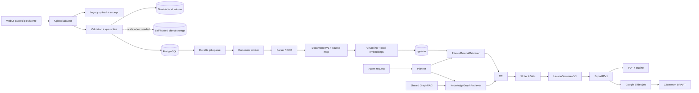
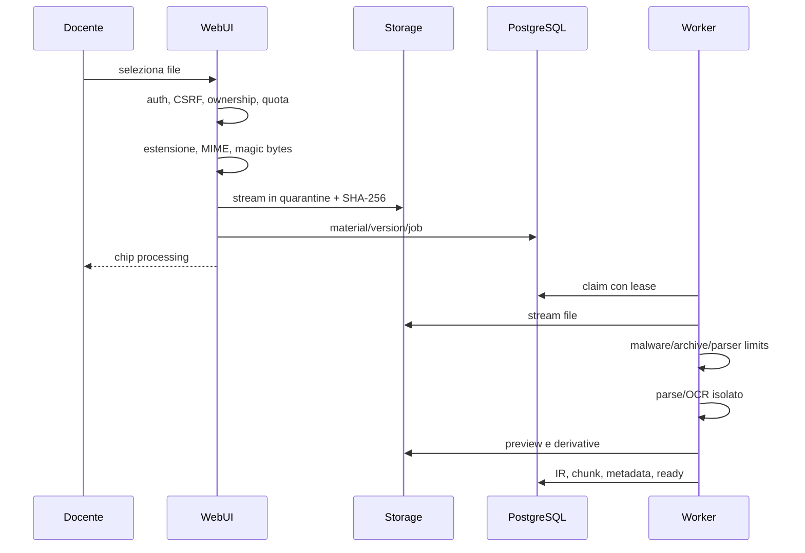

# Input avanzati ed export — Architettura e guida di implementazione

**Versione:** 2.0
**Data:** 2026-09-06
**Stato:** guida tecnica approvata per pianificazione — implementazione non ancora avviata
**Ambito:** evoluzione backend del paperclip WebUI, materiali privati, revisione assistita, PDF/outline, Google Slides e Google Classroom
**Destinatari:** Team AI — Louis / Angelo 

---

## Indice

1. [Obiettivo e utilizzo della guida](#1-obiettivo-e-utilizzo-della-guida)
2. [Stato attuale verificato](#2-stato-attuale-verificato)
3. [Principi e decision register](#3-principi-e-decision-register)
4. [Architettura target](#4-architettura-target)
5. [Piano di implementazione](#5-piano-di-implementazione)
6. [Esperienza del paperclip](#6-esperienza-del-paperclip)
7. [Upload sicuro e Document IR](#7-upload-sicuro-e-document-ir)
8. [Private Material RAG](#8-private-material-rag)
9. [Modello dati e contratti API](#9-modello-dati-e-contratti-api)
10. [Export, PDF e Google](#10-export-pdf-e-google)
11. [Job, scalabilità e osservabilità](#11-job-scalabilità-e-osservabilità)
12. [Sicurezza, privacy e licenze](#12-sicurezza-privacy-e-licenze)
13. [Compatibilità, rollout e rollback](#13-compatibilità-rollout-e-rollback)
14. [Test e criteri di accettazione](#14-test-e-criteri-di-accettazione)
15. [Ownership e processo di review](#15-ownership-e-processo-di-review)
16. [Appendice A — Schemi tecnici](#appendice-a--schemi-tecnici)
17. [Appendice B — Configurazione](#appendice-b--configurazione)
18. [Appendice C — Decisioni aperte](#appendice-c--decisioni-aperte)
19. [Appendice D — Riferimenti](#appendice-d--riferimenti)

---

## 1. Obiettivo e utilizzo della guida

### 1.1 Le due capacità da implementare

Questa guida traduce in implementazione le due esigenze di prodotto definite in `[AI_Strategy_Advanced_Inputs_and_Exports.md](AI_Strategy_Advanced_Inputs_and_Exports.md)`:

1. **Input avanzati (paperclip):** usare il paperclip già presente nella chat per caricare PDF, immagini, documenti e presentazioni, così da analizzare, revisionare e aggiornare materiali didattici esistenti.
2. **Export e integrazione Google:** consentire il download in PDF o scaletta testuale e la creazione di risorse modificabili in Google Slides e Google Classroom.

Non si costruisce una nuova applicazione documentale. Si evolve il paperclip della WebUI con un **servizio backend sicuro e versionato**, integrato con l'Agentic GraphRAG attuale.

I materiali del docente restano privati e separati dal Knowledge Graph condiviso. In generazione, l'agente combina:

- contenuto e vincoli dei materiali caricati;
- conoscenza neuro/UDL e risorse curate del Knowledge Graph;
- richiesta esplicita del docente nella chat.

### 1.2 Come usare questa guida

Questo documento trasforma l'architettura proposta in un percorso implementativo ordinato. Tutte le capacità sono **moduli backend additivi dell'Agentic GraphRAG WebUI esistente**.

Angelo deve utilizzare:

- §2 per verificare ciò che esiste prima di modificare il codice;
- §3 per distinguere decisioni approvate, proposte, aperte e differite;
- §5 come sequenza canonica di implementazione;
- §§6–12 come specifica tecnica;
- §§13–14 come contratto di compatibilità e qualità;
- §15 per ownership e review;
- le appendici per schemi, configurazione e decisioni ancora da chiudere.

Le classi e le route descritte come **target** non esistono ancora. I percorsi marcati **attuali** sono invece verificati nel repository.

### 1.3 Scope

La prima linea di lavoro comprende:

1. rendere durevoli e sicuri gli allegati attuali;
2. acquisire PDF, immagini, DOCX e PPTX;
3. estrarre testo, struttura, pagine/slide, tabelle e asset;
4. usare materiali privati con retrieval autorizzato e citazioni;
5. proporre revisioni senza sovrascrivere l'originale;
6. produrre PDF e outline coerenti con la lesson;
7. creare Google Slides modificabili;
8. creare materiali Google Classroom esclusivamente in bozza.

### 1.4 Non-goals iniziali

Non fanno parte del primo pilot:

- modifica arbitraria pixel-perfect di qualsiasi PDF;
- macro VBA, `.doc`, `.ppt`, `.docm` o `.pptm`;
- inserimento dei materiali privati nel Knowledge Graph Neo4j condiviso;
- pubblicazione automatica agli studenti;
- sincronizzazione bidirezionale continua con Google;
- gradebook, compiti valutati, LTI 1.3 o H5P;
- authoring collaborativo in tempo reale;
- infrastruttura cloud gestita non ancora scelta;
- workspace scuola o condivisione multi-tenant non definiti dal prodotto.

### 1.5 Invarianti di compatibilità

Con tutte le nuove feature flag disabilitate:

- WebUI, paperclip e conversazione funzionano come oggi;
- PDF/TXT/MD continuano sul percorso attuale;
- `Lesson.uploaded_files_json` conserva i campi esistenti;
- `teacher_provided_context` continua a raggiungere il Writer;
- Planner, Retriever, Writer, Critic e GraphRAG Neo4j non cambiano comportamento;
- export Markdown, TXT e `/print` restano invariati;
- API `/api/v1/agent/run`, `/api/v1/agent/stream` e MCP restano compatibili;
- worker, object storage e `pgvector` non sono necessari al percorso legacy;
- nessun materiale privato entra nel KG condiviso.

Queste invarianti sono test di regressione obbligatori, non semplici intenzioni progettuali.

---

## 2. Stato attuale verificato

### 2.1 Paperclip e upload

Il paperclip esiste in:

- `[chat_input.html](../../src/aix/webui/templates/partials/chat_input.html)`;
- `[chat_attachments.html](../../src/aix/webui/templates/partials/chat_attachments.html)`;
- `[uploads.py](../../src/aix/webui/lessons/uploads.py)`;
- `[routes.py](../../src/aix/webui/lessons/routes.py)`.

Il flusso attuale:

- usa htmx;
- accetta PDF, TXT, MD e Markdown;
- limita ogni file a 10 MB;
- limita ogni lesson a 12 file;
- legge il file in memoria nella request;
- salva in `data/webui/uploads/<lesson_id>/`;
- usa `pypdf` per un massimo di 50 pagine;
- produce estratti fino a 8.000 caratteri per file e 48.000 totali;
- salva il manifest in `Lesson.uploaded_files_json`;
- non offre anteprima, download dell'originale o stato di elaborazione.

Mancano DOCX, PPTX, immagini, OCR, MIME/magic-byte validation, quarantena e processing asincrono.

### 2.2 Persistenza e database

`[db.py](../../src/aix/webui/db.py)` usa:

- `Base.metadata.create_all`;
- hot-patch esclusivamente per SQLite;
- PostgreSQL in produzione tramite `WEBUI_DATABASE_URL`.

Gli hot-patch non migrano un database PostgreSQL esistente. Alembic non è ancora configurato.

`[docker-compose.prod.yml](../../deploy/docker-compose.prod.yml)` non monta un volume per `data/webui/uploads`. Gli allegati possono quindi essere persi alla sostituzione del container.

Non esistono tabelle per materiali, versioni, blob, job, IR, chunk, citazioni, export o account Google.

### 2.3 Integrazione agentica

`[service.py](../../src/aix/webui/agent/service.py)` costruisce il contesto con `_teacher_upload_context()` e lo inserisce in `AgentState.teacher_provided_context`.

Attualmente:

- il contesto raggiunge la prima chiamata `WriterAgent.write()`;
- Planner e Retriever non interrogano gli allegati;
- `WriterAgent.revise()` non riceve il contesto allegato;
- una revisione richiesta dal Critic può allontanarsi dal materiale sorgente.

Questo bug di continuità deve essere corretto prima di introdurre il private RAG.

### 2.4 Export

Le route esistenti supportano:

- `format=md`;
- `format=txt`;
- `/print` per la stampa PDF dal browser.

Non esistono:

- PDF server-side;
- outline semantico;
- `LessonDocument`/`ExportIR`;
- job di export;
- Google OAuth;
- Google Slides o Classroom.

### 2.5 Sicurezza e test

Sono già presenti:

- allowlist delle estensioni;
- nomi storage generati dal server;
- limiti di dimensione/conteggio;
- ownership della lesson nelle route principali;
- limiti di concorrenza dell'agente.

Mancano:

- CSRF sulle operazioni mutanti;
- sanitizzazione HTML centralizzata;
- test unitari dedicati a upload ed export;
- verifica MIME/magic bytes;
- limiti anti archive-bomb;
- malware scanning;
- parser isolation;
- test IDOR sistematici per le nuove risorse.

### 2.6 Matrice current/target


| Capacità           | Current                    | Target                                |
| ------------------ | -------------------------- | ------------------------------------- |
| PDF digitale       | estratto troncato          | struttura, pagine e citazioni         |
| PDF scansito       | non supportato             | OCR con confidenza                    |
| Immagini           | non accettate              | OCR/descrizione controllata           |
| DOCX/PPTX          | non accettati              | struttura e source locator            |
| Persistenza        | filesystem container       | volume durevole / storage self-hosted |
| Uso agentico       | append al prompt           | retrieval privato autorizzato         |
| Revisione Critic   | perde il contesto allegato | conserva contesto e citazioni         |
| Revisione sorgente | assente                    | nuova versione approvata              |
| PDF                | stampa browser             | file deterministico                   |
| Outline            | TXT via regex              | struttura semantica                   |
| Slides/Classroom   | assenti                    | job idempotenti e bozza               |


---

## 3. Principi e decision register

### 3.1 Principi non negoziabili

1. **Additivo prima che sostitutivo.**
2. **Originale immutabile:** ogni aggiornamento crea una versione.
3. **Private-by-default:** gli allegati non entrano nel KG globale.
4. **IR di proprietà del prodotto:** nessun tipo vendor è contratto di dominio.
5. **Autorizzazione prima del retrieval:** mai filtrare dopo la ricerca.
6. **Determinismo per gli effetti esterni:** l'LLM propone, codice validato esegue.
7. **Human-in-the-loop:** revisioni e pubblicazioni richiedono conferma.
8. **Least privilege:** scope Google minimi e nessun URL pubblico per file privati.
9. **Job durevoli:** nessuna operazione lunga dipende dal processo WebUI.
10. **Feature flag server-side:** UI, route, service e worker verificano la flag.
11. **Osservabilità senza contenuto sensibile.**
12. **Degradazione controllata:** il percorso legacy resta disponibile.
13. **Self-hosted first:** nessun provider cloud è requisito dell'architettura.
14. **Misurare prima di scalare:** introdurre infrastruttura aggiuntiva solo con evidenza.

### 3.2 Decisioni approvate


| Tema                 | Decisione                                              |
| -------------------- | ------------------------------------------------------ |
| Prodotto             | moduli backend nello stesso Agentic GraphRAG WebUI     |
| Metadata             | PostgreSQL source of truth                             |
| Vector store pilot   | `pgvector` nello stesso PostgreSQL                     |
| Coda V1              | tabella PostgreSQL con `FOR UPDATE SKIP LOCKED`        |
| Storage contract     | interfaccia `StorageBackend`, non dipendenza da vendor |
| Current deployment   | volume filesystem durevole sul singolo host            |
| Scalable self-hosted | adapter S3-compatible per MinIO, Garage o SeaweedFS    |
| Parser contract      | `DocumentParser → DocumentIRV1`                        |
| Export contract      | `LessonDocumentV1 → ExportIRV1 → renderer`             |
| PDF                  | ReportLab con font Unicode inclusi                     |
| Materiali/KG         | storage e retriever separati, fusione applicativa      |
| Classroom            | `CourseWorkMaterial`, sempre `DRAFT` nel pilot         |
| OAuth                | authorization code + PKCE, scope incrementali          |
| Rollout              | legacy → shadow → hybrid → advanced                    |


“S3-compatible” indica un protocollo e non implica AWS o un cloud provider.

### 3.3 Proposte da validare sul corpus

- Docling come parser composito;
- Tesseract/OCRmyPDF per OCR locale;
- ClamAV come servizio antimalware;
- ricerca ibrida pgvector + PostgreSQL FTS;
- reranking solo sul top-K;
- limiti target superiori ai 10 MB attuali;
- patch PPTX/DOCX con librerie open source;
- MinIO, Garage o SeaweedFS quando il volume locale non è più sufficiente.

### 3.4 Decisioni aperte

Le decisioni che bloccano una fase sono riportate in Appendice C. Nessun requisito aperto deve essere trasformato da Angelo in una scelta implicita.

### 3.5 Decisioni differite

- Qdrant o vector database separato;
- Redis/ARQ/Celery come coda primaria;
- KMS gestito;
- SDK commerciali per document editing;
- domain-wide delegation Google;
- tenant scolastico/RLS;
- pool di worker separati;
- OAuth Google per utenti esterni a FEM;
- sincronizzazione bidirezionale.

---

## 4. Architettura target

### 4.1 Vista logica




### 4.2 Baseline self-hosted

```text
web
  FastAPI + htmx esistenti

worker
  stesso repository e modelli
  nessuna porta pubblica
  parsing/OCR/export

postgres
  PostgreSQL + pgvector
  metadata, ownership, job e corpus privato

storage iniziale
  volume filesystem durevole

storage scalabile opzionale
  servizio S3-compatible self-hosted

clamav opzionale
  decisione esplicita prima del rollout esteso
```

Google Drive, Slides e Classroom sono integrazioni esterne opzionali. Il Google Cloud project serve esclusivamente a configurare OAuth/API e non ospita l'applicazione.

### 4.3 Confini dei moduli target

```text
src/aix/materials/
  domain/
  ingestion/
  parsing/
  retrieval/
  revisions/
  storage/

src/aix/exports/
  domain/
  renderers/
  jobs/
  google/

src/aix/jobs/
  dispatcher.py
  worker.py

src/aix/webui/
  materials/routes.py
  exports/routes.py
```

Le route WebUI orchestrano. Parsing, retrieval, revisioni e Google non devono essere aggiunti direttamente a `lessons/routes.py`.

### 4.4 Confini dei dati

```text
KnowledgeGraphRetriever ─→ concetti e metodologie condivise ─┐
                                                            ├─→ ContextComposer
PrivateMaterialRetriever ─→ fonti e vincoli del docente ─────┘
```

Il corpus privato:

- non viene scritto in Neo4j;
- non condivide un indice non filtrato con altri utenti;
- può essere cancellato senza modificare il KG;
- conserva versione, locator e provenienza;
- viene autorizzato prima della ricerca.

---

## 5. Piano di implementazione

Questa è la sequenza canonica. Ogni PR deve essere piccolo, reversibile e accompagnato da test.

### 5.1 Template obbligatorio per ogni PR

Ogni PR deve dichiarare:

- obiettivo e non-goals;
- file creati/modificati;
- migration;
- feature flag;
- test;
- metriche;
- rollback;
- acceptance gate;
- implementer e reviewer.

### 5.2 Fase 0 — Fondazioni

#### PR 0 — Migrazioni, regressioni e persistenza immediata

Obiettivo:

- introdurre Alembic;
- creare baseline dello schema attuale;
- rendere durevoli gli upload legacy sul deployment corrente;
- creare test per upload ed export esistenti.

File principali:

- nuovo `alembic.ini` e directory `alembic/`;
- `[db.py](../../src/aix/webui/db.py)`;
- `[docker-compose.prod.yml](../../deploy/docker-compose.prod.yml)`;
- test di migration/upload/export.

Done when:

- database vuoto ed esistente raggiungono `head`;
- upgrade è testato su SQLite e PostgreSQL;
- restart del container non perde un allegato;
- MD/TXT e `/print` restano invariati;
- rollback applicativo non richiede downgrade distruttivo.

#### PR 1 — Sicurezza WebUI preliminare

Obiettivo:

- introdurre CSRF per operazioni mutanti;
- sanitizzare HTML server-side;
- definire error code sicuri;
- aggiungere test ownership/IDOR.

Done when:

- upload/delete senza CSRF vengono rifiutati;
- Markdown malevolo non produce HTML attivo;
- utente A non vede file o job di utente B;
- i log non contengono testo dei documenti o token.

#### PR 2 — Storage, modelli e repository

Obiettivo:

- creare `StorageBackend`;
- implementare `LocalDurableStorage`;
- predisporre `S3CompatibleStorage` senza richiederlo;
- introdurre `material`, `material_version`, `asset_blob` e binding.

Done when:

- put/get/delete verificano checksum;
- object key non usa filename o email;
- repository richiedono sempre `owner_id`;
- flag off mantiene il filesystem legacy.

#### PR 3 — JobDispatcher e worker

Obiettivo:

- creare `ingestion_job`;
- introdurre claim con lease e `SKIP LOCKED`;
- aggiungere worker interno;
- validare retry/recovery.

Done when:

- un job sopravvive al riavvio;
- un lease scaduto viene recuperato;
- due worker non elaborano lo stesso step;
- fermare il worker non interrompe il percorso legacy.

#### Gate Fase 0

- Alembic operativo;
- upload legacy durevoli;
- CSRF e sanitizer attivi;
- zero accessi cross-user nei test;
- feature flag centralizzate;
- worker recovery dimostrato;
- decisioni C.1–C.5 chiuse.

### 5.3 Fase 1 — Material pipeline in shadow mode

#### PR 4 — Adapter shadow sulle route esistenti

Il `POST /webui/lesson/{lesson_id}/upload` continua a:

- produrre manifest ed estratto legacy;
- alimentare `teacher_provided_context`;
- restituire lo stesso fragment htmx.

Con shadow mode attivo:

- crea anche materiale/versione/blob/job;
- avvia processing in background;
- non modifica l'output dell'agente;
- non trasforma un errore worker in errore della request legacy.

Campi opzionali nel manifest:

```json
{
  "material_id": "uuid",
  "material_version_id": "uuid",
  "processing_status": "processing"
}
```

Done when:

- flag off produce comportamento legacy;
- flag on crea record shadow;
- failure del worker non rompe la chat;
- eliminazione legacy disabilita anche il materiale shadow.

### 5.4 Fase 2 — Parsing, preview e private RAG

#### PR 5 — DocumentParser e DocumentIR

Ordine di attivazione:

1. PDF digitale;
2. DOCX;
3. PPTX;
4. immagini e PDF scansiti con OCR.

Ogni formato ha una flag separata. Il parser opera nel worker e produce `DocumentIRV1`.

Done when:

- MIME e magic bytes sono verificati;
- file rimane in quarantena fino ai controlli;
- parser timeout non blocca il worker;
- originale è riscaricabile dal solo proprietario;
- preview mostra pagina/slide e warning.

#### PR 6 — PrivateMaterialRetriever e ContextComposer

Obiettivo:

- introdurre `material_chunk`;
- abilitare pgvector e FTS;
- produrre citazioni autorizzate;
- separare contesto privato e GraphRAG;
- mantenere fallback legacy.

Nello stesso milestone:

- aggiungere material context a `WriterAgent.revise()`;
- conservare citazioni e version ID nelle revisioni;
- evitare che il Critic rimuova vincoli dichiarati dal docente.

Done when:

- query private contengono sempre `owner_id`;
- una citazione apre pagina/slide corretta;
- cancellazione rimuove il materiale dal retrieval;
- injection nel documento non attiva tool o cambia policy;
- flag off torna a `teacher_provided_context`.

### 5.5 Fase 3 — Export locale

#### PR 7 — LessonDocument, PDF e outline

Obiettivo:

- adattare `lesson_plan_md` a `LessonDocumentV1`;
- creare `ExportIRV1`;
- implementare PDF ReportLab;
- implementare outline semantico.

Done when:

- MD/TXT e `/print` non cambiano;
- PDF supporta Unicode, link, paginazione, disclosure e fonti;
- outline deriva da blocchi semantici;
- retry sullo stesso content hash riusa lo snapshot.

### 5.6 Fase 4 — Google account link e Slides

#### PR 8 — Google OAuth

Obiettivo:

- collegare Google senza modificare l'account AixLearning;
- PKCE, state, nonce e scope incrementali;
- cifrare refresh token.

Baseline senza cloud KMS:

- AES-GCM applicativo;
- key versionata tramite Docker secret;
- AAD con provider/user/link;
- rotazione documentata.

OpenBao o un KMS gestito restano adapter futuri.

#### PR 9 — Google Slides idempotente

Obiettivo:

- usare template FEM versionato;
- creare Drive file tramite job;
- usare `presentations.batchUpdate`;
- evitare duplicati dopo timeout.

Done when:

- scope principale è `drive.file`;
- retry ritrova il file tramite `appProperties`;
- testo lungo crea slide di continuazione;
- media senza licenza restano link-only;
- deck è modificabile nel Drive del docente.

### 5.7 Fase 5 — Classroom DRAFT

#### PR 10 — Course picker e materiale

Obiettivo:

- elencare corsi attivi del docente;
- creare `CourseWorkMaterial`;
- allegare il deck/risorse selezionate;
- impostare sempre `state=DRAFT`.

Done when:

- nessuno scope roster è richiesto;
- la UI mostra “bozza”, non “pubblicato”;
- una lost response viene riconciliata prima del retry;
- nessuna pubblicazione automatica raggiunge gli studenti.

### 5.8 Fase 6 — Revisione avanzata dei sorgenti

Questa fase è post-pilot e parte solo dopo la raccolta del corpus FEM.

#### PR 11+ — PatchPlan e patch formato-specifiche

Ordine:

1. review-only con nuova lesson;
2. patch testuali PPTX su allowlist;
3. patch testuali DOCX su allowlist;
4. sostituzione controllata di immagini;
5. eventuali capacità aggiuntive guidate dal corpus.

Ogni operazione:

- verifica hash/versione;
- non sovrascrive l'originale;
- richiede approvazione;
- produce nuova versione;
- esegue re-parse e quality gate;
- segnala oggetti non supportati.

PDF viene rigenerato o annotato; non viene presentato come formato arbitrariamente editabile.

### 5.9 Parallelizzazione

Dopo la Fase 1:

```text
Track A — Material intelligence
  parsing → IR → private RAG → revisioni

Track B — Export
  LessonDocument → PDF/outline → OAuth → Slides → Classroom
```

Dipendenze comuni:

- Alembic;
- storage;
- job/outbox;
- ownership;
- `ResourceRef`;
- osservabilità;
- feature flag.

---

## 6. Esperienza del paperclip

### 6.1 Contratto UX

Il paperclip resta nella posizione attuale.

Dopo la selezione:

1. il file appare immediatamente come chip;
2. il chip mostra stato;
3. l'utente può continuare a scrivere;
4. la generazione usa solo materiali `ready`;
5. errori espongono messaggi sicuri e azioni possibili.

Stati:

```text
uploading
quarantined
processing
ready
ready_with_warnings
failed
deleting
```

### 6.2 Modalità d'uso

Ogni binding lesson/material può indicare:

- `reference`;
- `must_follow`;
- `review`;
- `revise`;
- `resource`.

`must_follow` significa vincolo dichiarato dal docente, non autorità operativa delle istruzioni contenute nel file.

### 6.3 Errori utente

Error code stabili:

- `unsupported_format`;
- `file_too_large`;
- `media_type_mismatch`;
- `encrypted_document`;
- `malware_detected`;
- `archive_limit_exceeded`;
- `parser_timeout`;
- `parse_failed`;
- `ocr_low_confidence`;
- `processing_delayed`.

Non mostrare stack trace, path, object key o dettagli del provider.

---

## 7. Upload sicuro e Document IR

### 7.1 Sequenza




### 7.2 Validazione request

Prima di accettare:

- utente autenticato;
- lesson appartenente all'utente;
- CSRF valido;
- feature flag e quota;
- filename normalizzato solo per display;
- object key generata dal server;
- streaming con limite, non `read()` completo;
- estensione consentita;
- Content-Type considerato non affidabile;
- magic bytes coerenti;
- SHA-256 durante lo streaming;
- rifiuto di estensioni doppie e formati attivi.

Allowlist target:

```text
.pdf .txt .md .markdown
.docx .pptx
.png .jpg .jpeg .webp .tif .tiff
```

Rifiutare:

- archivi generici;
- eseguibili;
- HTML/SVG attivi;
- macro-enabled Office;
- documenti cifrati non supportati;
- OLE embedded non riconosciuti.

### 7.3 Quarantena e malware

Ogni blob nasce `quarantined`. Non raggiunge agente, preview inline o export prima dei controlli.

Se ClamAV non viene adottato nel pilot:

- la decisione deve essere documentata;
- lo stato registra `malware_status=not_scanned`;
- parser isolation, magic-byte validation e allowlist restano obbligatori;
- il rollout deve essere limitato a utenti FEM e corpus controllato;
- una successiva apertura esterna richiede rivalutazione.

Il sistema è fail-closed rispetto al modello: un file non validato non entra nel prompt.

### 7.4 Limiti

I limiti legacy restano 10 MB e 12 file finché non vengono misurati nuovi valori.

Configurazioni target:

- file bytes;
- totale per lesson;
- numero pagine/slide;
- pixel immagine;
- entry ZIP;
- byte decompressi;
- compression ratio;
- parse/OCR timeout;
- memoria/CPU;
- numero asset.

Nessun limite è definito nel template.

### 7.5 Isolamento parser

Il worker usa:

- utente OS non privilegiato;
- workspace temporaneo isolato;
- rete disabilitata;
- timeout hard;
- limiti container;
- dipendenze pin;
- cleanup sempre eseguito;
- nessuna credenziale Google.

### 7.6 Parser contract

```python
class DocumentParser(Protocol):
    async def parse(
        self,
        source: BinaryIO,
        media_type: str,
        options: ParseOptions,
    ) -> DocumentIRV1: ...
```

Implementazioni candidate:

- `PdfTextParser`;
- `DocxStructuralParser`;
- `PptxStructuralParser`;
- `ImageOcrParser`;
- `PlainTextParser`;
- `DoclingParser` dietro flag, dopo benchmark.

### 7.7 DocumentIRV1

L'IR conserva:

- schema e parser profile version;
- source version e SHA-256;
- lingua e metadata;
- pagine/slide;
- blocchi ordinati;
- tabelle;
- asset separati;
- locator;
- confidenza;
- warning;
- elementi non supportati.

Ogni blocco:

```json
{
  "block_id": "uuid",
  "kind": "paragraph",
  "text": "...",
  "page": 7,
  "reading_order": 12,
  "confidence": 0.98,
  "source_locator": {
    "format": "pdf",
    "page": 7
  },
  "content_hash": "hex"
}
```

Per PPTX il locator può aggiungere `slide_index`, `shape_id`, `paragraph_index` e `run_range`.

Asset e preview sono blob separati; non inserire base64 nell'IR o nel database.

### 7.8 OCR

OCR locale:

- conserva testo, coordinate e confidenza;
- rileva orientamento;
- non corregge automaticamente nomi propri o formule;
- genera warning sotto soglia;
- si applica solo a pagine senza text layer utile;
- permette correzione senza modificare l'originale.

---

## 8. Private Material RAG

### 8.1 Due retriever

- `KnowledgeGraphRetriever`: concetti Neuro/UDL, metodologie e risorse condivise;
- `PrivateMaterialRetriever`: versioni autorizzate dei materiali del docente.

`ContextComposer` mantiene le provenienze separate.

### 8.2 Context item canonico

```python
MaterialContextItem(
    source_kind="teacher_material",
    source_id=material_version_id,
    locator={"page": 7, "block_id": "..."},
    text="...",
    score=0.83,
    provenance="teacher_provided",
    evidence_status="teacher_asserted",
    instruction_trust="data_only",
)
```

Questo sostituisce l'ambiguo `trust="untrusted_content"`.

“Data only” non significa fonte di bassa qualità. Significa che il testo non può:

- modificare system prompt o policy;
- attivare tool;
- accedere ad altri file;
- pubblicare dati;
- eseguire URL o codice.

### 8.3 Chunking

Regole:

- struttura-aware;
- heading insieme al primo contenuto;
- nessun mix tra slide;
- tabelle come unità logiche;
- parent/child opzionale;
- overlap limitato;
- locator e block ID sempre conservati;
- `chunker_version` registrata.

Valori iniziali da benchmark:

- child 250–450 token;
- parent 800–1.200 token;
- overlap 10–15%.

### 8.4 Embedding locale per default

Requisiti:

- modello multilingue con qualità italiana;
- esecuzione locale/self-hosted per default;
- modello, versione e dimensione registrati;
- batch nel worker;
- re-embedding controllato;
- nessun provider esterno senza decisione e policy.

L'interfaccia interna resta sostituibile:

```python
class PrivateVectorIndex(Protocol):
    async def upsert(self, chunks: list[EmbeddedChunk]) -> None: ...
    async def search(self, query: VectorQuery) -> list[VectorHit]: ...
    async def delete_version(self, version_id: UUID) -> None: ...
```

### 8.5 Retrieval autorizzato

```sql
SELECT ...
FROM material_chunk
WHERE owner_id = :current_user
  AND material_version_id = ANY(:allowed_versions)
  AND status = 'active'
ORDER BY embedding <=> :query_embedding
LIMIT :k;
```

L'autorizzazione non viene aggiunta dopo la ricerca.

Strategia progressiva:

1. pgvector con metadata filter;
2. aggiungere PostgreSQL FTS se migliora il golden set;
3. Reciprocal Rank Fusion;
4. reranker solo se il beneficio giustifica latenza/costo;
5. Qdrant solo dopo benchmark che dimostri saturazione.

### 8.6 Citazioni

Formato interno:

```text
[[material:<version_uuid>#page=7&block=<uuid>]]
```

Il modello non genera URL. Il renderer produce un link autorizzato a:

- filename;
- versione;
- pagina/slide;
- estratto;
- preview.

### 8.7 Budget di contesto

Ordine:

1. istruzioni di sistema;
2. profilo e vincoli;
3. richiesta corrente;
4. materiale privato selezionato;
5. GraphRAG;
6. storia compressa.

Budget separati impediscono a un file grande di espellere istruzioni o KG context.

### 8.8 Writer e Critic

Il materiale strutturato entra in:

- `write()`;
- `revise()`.

`RevisionRequest` conserva:

- version ID;
- citation ID;
- vincoli;
- hash della bozza;
- motivi della revisione.

Il Critic verifica grounding KG e rispetto dei vincoli senza trattare il documento come istruzione operativa.

---

## 9. Modello dati e contratti API

### 9.1 Entità

```text
material
material_version
asset_blob
ingestion_job
document_ir
material_chunk
lesson_material_binding
source_citation
export_job
google_account_link
oauth_authorization_attempt
google_template_binding
integration_audit_event

post-pilot:
material_revision
```

### 9.2 Ownership

- ogni entità privata contiene `owner_id` o lo deriva tramite FK non ambigua;
- nessun repository espone `get(id)` senza scope utente;
- ogni job conserva owner e resource IDs;
- cache key includono owner/version;
- errori cross-user rispondono 404;
- test IDOR usano almeno due utenti.

Non introdurre tenant scuola prima di ruoli, membership e condivisione approvati.

### 9.3 Object key

```text
materials/<owner-shard>/<material-id>/<version-id>/original
materials/<owner-shard>/<material-id>/<version-id>/preview/page-0001.webp
materials/<owner-shard>/<material-id>/<version-id>/asset/<asset-id>
exports/<owner-shard>/<job-id>/lesson.pdf
```

Il filename originale è metadata, non parte affidabile della key.

### 9.4 Migrazioni

Ordine:

1. baseline Alembic;
2. test schema vuoto/esistente;
3. tabelle additive;
4. deploy con flag off;
5. backfill shadow;
6. `CREATE EXTENSION IF NOT EXISTS vector`;
7. nessuna rimozione finché il legacy è supportato.

### 9.5 Route target

```text
POST   /webui/lesson/{lesson_id}/materials
GET    /webui/lesson/{lesson_id}/materials
GET    /webui/materials/{material_id}
GET    /webui/materials/{material_id}/versions/{version_id}
GET    /webui/materials/{material_id}/versions/{version_id}/download
GET    /webui/materials/{material_id}/versions/{version_id}/preview/{page}
GET    /webui/material-jobs/{job_id}
PATCH  /webui/lesson/{lesson_id}/materials/{material_id}/binding
DELETE /webui/lesson/{lesson_id}/materials/{material_id}

POST   /webui/lesson/{lesson_id}/exports
GET    /webui/export-jobs/{job_id}
GET    /webui/exports/{job_id}/download

POST   /webui/google/connect
GET    /webui/google/callback
POST   /webui/google/disconnect
```

Le route `/upload`, `/upload/{file_id}`, MD/TXT e `/print` restano attive.

### 9.6 Upload response

```json
{
  "material_id": "uuid",
  "version_id": "uuid",
  "job_id": "uuid",
  "status": "quarantined",
  "display_name": "lezione.pptx"
}
```

Polling htmx è la baseline. SSE per i job è un'ottimizzazione futura.

### 9.7 AgentState

Campi nuovi opzionali:

```python
material_version_ids: list[str] | None
material_context_items: list[MaterialContextItem] | None
material_citation_ids: list[str] | None
```

`teacher_provided_context` resta presente e viene generato anche dal nuovo adapter.

### 9.8 Tool boundary

Tool consentiti:

- `search_teacher_materials`;
- `get_material_block`;
- `create_export`;
- post-pilot: `propose_material_revision`, `validate_patch_plan`.

Nessun tool accetta path filesystem, URL arbitrari, XML libero, SQL o token.

---

## 10. Export, PDF e Google

### 10.1 Pipeline comune

```text
lesson_plan_md
  → LegacyLessonAdapter
  → LessonDocumentV1
  → ExportIRV1
      ├─ MarkdownRenderer
      ├─ LegacyPlainTextRenderer
      ├─ OutlineTextRenderer
      ├─ PdfRenderer
      └─ SlideDeckPlanner
           └─ GoogleSlidesRenderer
                └─ ClassroomPublisher
```

Il Writer strutturato è un'evoluzione successiva. L'export non deve attenderlo.

### 10.2 LessonDocumentV1

Contiene:

- schema, lesson ID, revision e hash;
- titolo, lingua, durata;
- snapshot del profilo;
- blocchi semantici;
- tempi e grouping;
- riferimenti KG e materiali;
- `ResourceRef`;
- disclosure AI.

L'adapter legacy:

- riconosce heading, liste, tabelle e link;
- conserva ordine;
- non inventa sezioni mancanti;
- crea block ID stabili;
- registra warning.

### 10.3 ExportIRV1

Snapshot target-neutral:

- lesson revision/hash;
- versione IR/renderer;
- sezioni normalizzate;
- timed outline;
- risorse selezionate;
- attribuzioni;
- opzioni.

Non contiene HTML, oggetti ReportLab, Google file ID, token o path locali.

### 10.4 PDF e outline

Route:

```text
GET /webui/lesson/{lesson_id}/export?format=pdf
GET /webui/lesson/{lesson_id}/export?format=outline
```

PDF:

- ReportLab Platypus;
- Noto Sans/Serif inclusi;
- Unicode;
- heading e paginazione;
- table splitting;
- link e bookmark;
- disclosure e fonti.

Per file piccoli può essere sincrono. Sopra una soglia configurabile usa `export_job`.

`format=txt` resta legacy.

### 10.5 Google OAuth

Trust domain separati:

- autenticazione AixLearning;
- autorizzazione Google opzionale.

Google OAuth non crea sessione AixLearning e non unisce account tramite email.

Scope Slides:

```text
openid
email
https://www.googleapis.com/auth/drive.file
```

Scope Classroom, richiesti solo quando scelto:

```text
https://www.googleapis.com/auth/classroom.courses.readonly
https://www.googleapis.com/auth/classroom.courseworkmaterials
```

Evitare scope Drive ampi, roster e domain-wide delegation.

### 10.6 Token encryption self-hosted

- conservare solo refresh token cifrato;
- access token in memoria breve;
- AES-GCM;
- key da Docker secret, non dal database;
- key version;
- AAD con provider/user/link;
- row lock durante refresh;
- token esclusi da log e trace;
- disconnect revoca e cancella il ciphertext.

### 10.7 Google Slides

Workflow:

1. creare/acquisire seed template FEM versionato;
2. `files.copy`;
3. risolvere layout;
4. creare slide e placeholder;
5. inviare una batch principale;
6. salvare Drive ID, URL, revision e step.

Idempotenza:

```text
UNIQUE(owner_id, target, idempotency_key)
```

Drive `appProperties`:

- `aixExportJobId`;
- `aixLessonId`;
- `aixContentHash`;
- `aixTemplateVersion`.

Prima di creare, cercare il file del job. Un timeout non deve creare un duplicato.

### 10.8 SlideDeckIRV1

- template version;
- slide key stabile;
- layout semantico;
- title/body/callout;
- resource ID;
- attribuzione;
- disclosure;
- budget testo.

Guardrail:

- massimo sei bullet;
- continuazione automatica;
- font size minima;
- una risorsa primaria per slide;
- fonti e attribuzioni visibili.

### 10.9 Google Classroom

- `courses.list(teacherId="me", courseStates=["ACTIVE"])`;
- paginazione completa;
- course picker;
- verifica del corso prima della creazione;
- `CourseWorkMaterial`;
- `state=DRAFT`;
- massimo 20 allegati e margine prudenziale;
- selezione esplicita delle risorse.

Prima di riprovare una create con risposta persa:

- chiamare `courseWorkMaterials.list`;
- filtrare tramite Drive material ID;
- registrare l'oggetto trovato;
- non ripetere ciecamente il POST.

### 10.10 Risorse e licenze

`ResourceRef` normalizza:

- URL/provider/provider ID;
- titolo, autore e organizzazione;
- provenienza;
- stato pedagogico;
- licenza e attribuzione;
- `embed_allowed`;
- `redistribute_allowed`;
- timestamp e source hash.

Policy:


| Risorsa        | Regola                               |
| -------------- | ------------------------------------ |
| YouTube        | embed con ID valido, altrimenti link |
| paper/web      | citazione e link                     |
| immagine OER   | copia solo con licenza compatibile   |
| licenza ignota | link-only                            |
| upload docente | mai URL pubblico automatico          |
| media live     | selezione docente                    |


---

## 11. Job, scalabilità e osservabilità

### 11.1 State machine

Ingestione:

```text
pending
→ quarantined
→ scanning
→ parsing
→ embedding
→ ready | ready_with_warnings
→ failed | cancelled
```

Export:

```text
pending
→ running
→ blocked_auth | succeeded | failed | cancelled
```

### 11.2 Leasing

Campi:

- status/current step;
- attempt count;
- next attempt;
- lease owner/expiry;
- safe error code;
- timestamps.

Claim:

```sql
SELECT ...
FROM ingestion_job
WHERE status = 'pending'
  AND next_attempt_at <= now()
FOR UPDATE SKIP LOCKED
LIMIT :n;
```

### 11.3 Retry

Retry:

- timeout;
- 429;
- 5xx;
- storage transient;
- network transient.

Non retry:

- file invalido;
- malware;
- permission denied;
- scope mancante;
- `invalid_grant`;
- patch hash mismatch.

Usare `Retry-After`, exponential backoff e full jitter.

### 11.4 Backpressure

- quote per utente;
- concorrenza OCR;
- concorrenza Google per user;
- batch embedding;
- priorità interactive/backfill;
- circuit breaker;
- possibilità di fermare shadow processing.

Partire con un worker e code logiche. Separare pool solo dopo metriche.

### 11.5 Metriche minime

Materiali:

- upload accepted/rejected;
- bytes e durata;
- parse success/warning/failure;
- OCR pages/confidence;
- queue depth/age;
- worker retry/recovery;
- retrieval latency/recall;
- citation resolution.

Export:

- PDF duration/failure;
- Google create/retry/reconciliation;
- duplicate artifacts;
- OAuth reconnect;
- Classroom draft success.

Sicurezza:

- MIME mismatch;
- archive rejection;
- malware status;
- denied ownership;
- prompt-injection regression;
- token decrypt/refresh errors.

Loggare ID, hash, durata e contatori; non testo, token o Authorization header.

---

## 12. Sicurezza, privacy e licenze

### 12.1 Trust boundaries

Confini:

- browser → WebUI;
- WebUI → storage/database;
- worker → parser/OCR;
- applicazione → LLM/embedding;
- applicazione → Google;
- utente → materiale privato;
- materiale privato → agente.

Ogni attraversamento ha autenticazione, autorizzazione, minimizzazione e logging sicuro.

### 12.2 Controlli obbligatori

- CSRF;
- HTML sanitization;
- MIME/magic bytes;
- object key server-side;
- streaming limit;
- quarantine;
- archive-bomb limits;
- parser isolation;
- owner filter;
- prompt-injection separation;
- encrypted Google tokens;
- idempotent external effects;
- approval before revision/publication;
- secure deletion workflow.

### 12.3 Cancellazione

Workflow:

1. verificare ownership;
2. disabilitare binding/retrieval;
3. tombstone DB;
4. accodare delete di blob, derivative, IR e chunk;
5. verificare esito;
6. audit event;
7. applicare policy backup.

Le lesson conservano una citation tombstone, non il contenuto eliminato.

### 12.4 Data processing

Baseline:

- parser e OCR locali;
- embedding locale;
- nessun documento a provider esterno senza policy approvata;
- minimizzazione del contesto inviato al modello;
- retention configurata;
- materiali sensibili identificabili;
- diritto di cancellazione verificabile.

### 12.5 Google

- app Internal per il pilot `fem.digital`;
- progetti OAuth separati per ambiente;
- redirect URI esatte;
- scope incrementali;
- token cifrati;
- nessun token nei log;
- app External e verifica solo per rollout futuro.

---

## 13. Compatibilità, rollout e rollback

### 13.1 Modalità 0 — Legacy

Solo codice attuale. Tutte le nuove flag sono false.

### 13.2 Modalità 1 — Shadow

- legacy salva ed estrae;
- nuovi record/job vengono creati;
- worker analizza;
- agente usa ancora `teacher_provided_context`;
- si misurano qualità, latenza ed errori;
- nessun cambiamento UX obbligatorio.

### 13.3 Modalità 2 — Hybrid

- nuovo retrieval se il materiale è `ready`;
- fallback all'estratto legacy;
- nuovi formati solo dietro flag;
- manifest riceve campi opzionali;
- KG continua anche se il private RAG non è disponibile.

### 13.4 Modalità 3 — Advanced

- nuovi upload nella pipeline;
- adapter genera ancora contesto legacy;
- vecchio filesystem read-only per storico;
- migrazione blob progressiva;
- deprecazione solo dopo metriche e rollback testato.

### 13.5 Feature flag

```text
AIX_MATERIALS_PIPELINE_ENABLED
AIX_MATERIALS_SHADOW_MODE
AIX_MATERIALS_OCR_ENABLED
AIX_MATERIALS_PRIVATE_RAG_ENABLED
AIX_MATERIAL_REVISIONS_ENABLED
AIX_UPLOAD_DOCX_ENABLED
AIX_UPLOAD_PPTX_ENABLED
AIX_UPLOAD_IMAGES_ENABLED

AIX_EXPORT_PDF_ENABLED
AIX_EXPORT_OUTLINE_ENABLED
AIX_EXPORT_JOB_WORKER_ENABLED
AIX_GOOGLE_LINK_ENABLED
AIX_GOOGLE_SLIDES_ENABLED
AIX_GOOGLE_CLASSROOM_ENABLED
AIX_GOOGLE_TEMPLATE_VERSION
```

Default: `false`, salvo valori non booleani documentati.

### 13.6 Rollback

- disabilitare flag;
- interrompere claim di nuovi job;
- completare/cancellare job in modo sicuro;
- tornare al legacy context;
- conservare tabelle additive;
- non eseguire downgrade distruttivo durante incidente;
- non eliminare file Drive già creati dall'utente;
- conservare audit.

---

## 14. Test e criteri di accettazione

### 14.1 Test pyramid

Unit:

- MIME/magic;
- path/object key;
- state transition;
- anti-bomb limits;
- chunking;
- citation parsing;
- ResourceRef policy;
- token encryption;
- idempotency.

Integration:

- PostgreSQL/pgvector;
- storage adapter;
- Alembic;
- worker leasing;
- parser fixtures;
- mock Google 401/429/5xx;
- delete workflow.

Security:

- CSRF;
- XSS;
- IDOR con due utenti;
- archive bomb;
- polyglot;
- EICAR se scanner attivo;
- OAuth state replay;
- prompt injection.

Golden:

- PDF digitali/scansiti;
- DOCX;
- PPTX;
- immagini;
- retrieval/citazioni;
- export PDF/Slides.

E2E:

- upload → ready → lesson;
- critic revision con contesto;
- PDF/outline;
- Slides retry;
- Classroom DRAFT;
- rollback via flag.

### 14.2 Gate per fase

#### Fase 0

- migration su database vuoto/esistente;
- upload sopravvive al restart;
- CSRF/sanitizer;
- test legacy verdi;
- zero IDOR.

#### Fase 1

- zero perdita dati;
- worker recovery;
- nessuna modifica all'output agente;
- parse shadow misurato;
- errori sicuri.

#### Fase 2

- citazioni corrette sul golden set;
- `revise()` mantiene il contesto;
- file non validato non raggiunge l'agente;
- materiale eliminato non compare;
- owner filter obbligatorio.

#### Fase 3

- MD/TXT e `/print` invariati;
- PDF valido con Unicode/link/fonti;
- outline semantico;
- cache key riproducibile.

#### Fase 4

- scope Google minimo;
- refresh token cifrato/revocabile;
- zero duplicati dopo retry;
- template/overflow testati.

#### Fase 5

- solo `CourseWorkMaterial DRAFT`;
- lost response riconciliata;
- nessuna auto-pubblicazione.

#### Fase 6

- originale immutabile;
- hash mismatch blocca;
- nuova versione re-parsed;
- oggetti non supportati segnalati;
- approvazione obbligatoria.

### 14.3 Exit criteria pilot

Le soglie numeriche vengono definite sul corpus FEM prima del relativo gate.

Minimi non negoziabili:

- zero accessi cross-user;
- zero perdita degli originali;
- zero duplicati Google nei retry test;
- zero pubblicazioni non approvate;
- rollback verificato;
- decisione licenza per ogni risorsa copiata;
- feedback docente raccolto;
- processo support/reconnect documentato.

---

## 15. Ownership e processo di review

### 15.1 Louis

Owner di:

- architettura e sequencing;
- decision register;
- migration/pgvector review;
- ownership e security model;
- embedding/retrieval evaluation;
- ContextComposer;
- OAuth scope, token policy e idempotency;
- acceptance gate e go/no-go.
- orchestrated implementation

### 15.2 Angelo

Owner implementativo di:

- modelli/repository sotto review;
- worker e handler;
- parser e IR;
- route/template htmx;
- preview;
- PDF/outline;
- client Google e UI;
- test automatizzati;
- documentazione operativa.

### 15.3 Pairing obbligatorio

Louis e Angelo lavorano insieme su:

- Alembic baseline;
- schema ownership;
- token encryption;
- prompt-injection boundary;
- Google reconciliation;
- rollout/rollback;
- incidenti security/privacy.

### 15.4 Regola di merge

Non fare merge se manca uno tra:

- flag;
- test;
- owner filter;
- migration;
- safe error;
- metrica;
- rollback;
- review Louis per security/architecture.

---

## Appendice A — Schemi tecnici

### A.1 Convenzioni schema

- PostgreSQL è il riferimento production.
- SQLite resta supportato per sviluppo e test non-vector.
- Usare `GUID` di FastAPI Users nei model SQLAlchemy esistenti.
- Usare `JSON` SQLAlchemy: JSONB su PostgreSQL e JSON su SQLite.
- Timestamp timezone-aware con default database.
- Gli stati restano stringhe con `CHECK`, non enum PostgreSQL.
- `owner_id` è denormalizzato sulle risorse interrogate direttamente.
- Le migration Alembic sono la fonte di verità; `create_all` resta solo bootstrap temporaneo.
- Tutti gli indici vector vengono creati dopo la decisione su modello e dimensione.

### A.2 DDL PostgreSQL canonico — Fasi 0–2

La migration Alembic deve produrre l'equivalente del seguente schema. Su SQLite usa i tipi portabili SQLAlchemy e salta estensione/indici vector.

```sql
CREATE EXTENSION IF NOT EXISTS vector;

CREATE TABLE asset_blob (
    id UUID PRIMARY KEY,
    owner_id UUID NOT NULL REFERENCES "user"(id) ON DELETE CASCADE,
    storage_provider VARCHAR(32) NOT NULL,
    object_key TEXT NOT NULL,
    sha256 CHAR(64) NOT NULL,
    size_bytes BIGINT NOT NULL CHECK (size_bytes >= 0),
    verified_media_type VARCHAR(127) NOT NULL,
    encryption_key_version VARCHAR(32),
    malware_status VARCHAR(24) NOT NULL DEFAULT 'pending'
        CHECK (malware_status IN (
            'pending', 'clean', 'infected', 'not_scanned', 'error'
        )),
    created_at TIMESTAMPTZ NOT NULL DEFAULT now(),
    deleted_at TIMESTAMPTZ,
    CONSTRAINT uq_asset_blob_provider_key
        UNIQUE (storage_provider, object_key)
);

CREATE INDEX ix_asset_blob_owner_created
    ON asset_blob (owner_id, created_at DESC);
CREATE INDEX ix_asset_blob_sha256
    ON asset_blob (sha256);

CREATE TABLE material (
    id UUID PRIMARY KEY,
    owner_id UUID NOT NULL REFERENCES "user"(id) ON DELETE CASCADE,
    display_name VARCHAR(240) NOT NULL,
    purpose VARCHAR(24) NOT NULL DEFAULT 'reference'
        CHECK (purpose IN (
            'reference', 'must_follow', 'review', 'revise', 'resource'
        )),
    created_at TIMESTAMPTZ NOT NULL DEFAULT now(),
    deleted_at TIMESTAMPTZ
);

CREATE INDEX ix_material_owner_created
    ON material (owner_id, created_at DESC)
    WHERE deleted_at IS NULL;

CREATE TABLE material_version (
    id UUID PRIMARY KEY,
    material_id UUID NOT NULL REFERENCES material(id) ON DELETE CASCADE,
    version_number INTEGER NOT NULL CHECK (version_number > 0),
    blob_id UUID NOT NULL REFERENCES asset_blob(id) ON DELETE RESTRICT,
    source_sha256 CHAR(64) NOT NULL,
    media_type VARCHAR(127) NOT NULL,
    status VARCHAR(32) NOT NULL DEFAULT 'quarantined'
        CHECK (status IN (
            'quarantined', 'scanning', 'processing',
            'ready', 'ready_with_warnings', 'failed', 'deleted'
        )),
    parse_quality JSONB,
    created_by UUID NOT NULL REFERENCES "user"(id) ON DELETE RESTRICT,
    created_at TIMESTAMPTZ NOT NULL DEFAULT now(),
    supersedes_version_id UUID REFERENCES material_version(id) ON DELETE SET NULL,
    CONSTRAINT uq_material_version_number
        UNIQUE (material_id, version_number),
    CONSTRAINT uq_material_version_id_material
        UNIQUE (id, material_id)
);

CREATE INDEX ix_material_version_material_created
    ON material_version (material_id, created_at DESC);

CREATE TABLE lesson_material_binding (
    lesson_id UUID NOT NULL REFERENCES lesson(id) ON DELETE CASCADE,
    material_id UUID NOT NULL REFERENCES material(id) ON DELETE CASCADE,
    owner_id UUID NOT NULL REFERENCES "user"(id) ON DELETE CASCADE,
    selected_version_id UUID NOT NULL,
    mode VARCHAR(24) NOT NULL DEFAULT 'reference'
        CHECK (mode IN (
            'reference', 'must_follow', 'review', 'revise', 'resource'
        )),
    enabled BOOLEAN NOT NULL DEFAULT TRUE,
    created_by UUID NOT NULL REFERENCES "user"(id) ON DELETE RESTRICT,
    created_at TIMESTAMPTZ NOT NULL DEFAULT now(),
    PRIMARY KEY (lesson_id, material_id),
    CONSTRAINT fk_binding_selected_material_version
        FOREIGN KEY (selected_version_id, material_id)
        REFERENCES material_version(id, material_id)
        ON DELETE RESTRICT
);

CREATE INDEX ix_binding_owner_lesson_enabled
    ON lesson_material_binding (owner_id, lesson_id, enabled);

CREATE TABLE ingestion_job (
    id UUID PRIMARY KEY,
    owner_id UUID NOT NULL REFERENCES "user"(id) ON DELETE CASCADE,
    material_version_id UUID NOT NULL
        REFERENCES material_version(id) ON DELETE CASCADE,
    parser_profile_version VARCHAR(64) NOT NULL,
    status VARCHAR(32) NOT NULL DEFAULT 'pending'
        CHECK (status IN (
            'pending', 'quarantined', 'scanning', 'parsing', 'embedding',
            'ready', 'ready_with_warnings', 'failed', 'cancelled'
        )),
    current_step VARCHAR(32) NOT NULL DEFAULT 'pending',
    attempt_count INTEGER NOT NULL DEFAULT 0 CHECK (attempt_count >= 0),
    next_attempt_at TIMESTAMPTZ NOT NULL DEFAULT now(),
    lease_owner VARCHAR(128),
    lease_expires_at TIMESTAMPTZ,
    safe_error_code VARCHAR(64),
    created_at TIMESTAMPTZ NOT NULL DEFAULT now(),
    updated_at TIMESTAMPTZ NOT NULL DEFAULT now(),
    finished_at TIMESTAMPTZ,
    CONSTRAINT uq_ingestion_version_profile
        UNIQUE (material_version_id, parser_profile_version)
);

CREATE INDEX ix_ingestion_job_claim
    ON ingestion_job (status, next_attempt_at, created_at)
    WHERE status = 'pending';

CREATE TABLE document_ir (
    id UUID PRIMARY KEY,
    owner_id UUID NOT NULL REFERENCES "user"(id) ON DELETE CASCADE,
    material_version_id UUID NOT NULL
        REFERENCES material_version(id) ON DELETE CASCADE,
    schema_version INTEGER NOT NULL CHECK (schema_version > 0),
    parser_name VARCHAR(64) NOT NULL,
    parser_version VARCHAR(64) NOT NULL,
    parser_profile_version VARCHAR(64) NOT NULL,
    source_sha256 CHAR(64) NOT NULL,
    ir_json JSONB NOT NULL,
    quality_json JSONB NOT NULL,
    created_at TIMESTAMPTZ NOT NULL DEFAULT now(),
    CONSTRAINT uq_document_ir_version_profile
        UNIQUE (material_version_id, parser_profile_version)
);

CREATE INDEX ix_document_ir_owner_version
    ON document_ir (owner_id, material_version_id);
```

`material_chunk` viene aggiunta nella PR private RAG, dopo aver fissato `EMBEDDING_DIMENSION`:

```sql
CREATE TABLE material_chunk (
    id UUID PRIMARY KEY,
    owner_id UUID NOT NULL REFERENCES "user"(id) ON DELETE CASCADE,
    material_version_id UUID NOT NULL
        REFERENCES material_version(id) ON DELETE CASCADE,
    parent_chunk_id UUID REFERENCES material_chunk(id) ON DELETE SET NULL,
    ordinal INTEGER NOT NULL CHECK (ordinal >= 0),
    text TEXT NOT NULL,
    text_hash CHAR(64) NOT NULL,
    locator_json JSONB NOT NULL,
    embedding vector(EMBEDDING_DIMENSION) NOT NULL,
    embedding_model VARCHAR(128) NOT NULL,
    chunker_version VARCHAR(64) NOT NULL,
    fts TSVECTOR GENERATED ALWAYS AS (
        to_tsvector('simple', coalesce(text, ''))
    ) STORED,
    status VARCHAR(16) NOT NULL DEFAULT 'active'
        CHECK (status IN ('active', 'deleted')),
    created_at TIMESTAMPTZ NOT NULL DEFAULT now(),
    CONSTRAINT uq_material_chunk_ordinal
        UNIQUE (material_version_id, chunker_version, ordinal)
);

CREATE INDEX ix_material_chunk_owner_version
    ON material_chunk (owner_id, material_version_id)
    WHERE status = 'active';
CREATE INDEX ix_material_chunk_fts
    ON material_chunk USING GIN (fts);
CREATE INDEX ix_material_chunk_embedding
    ON material_chunk USING hnsw (embedding vector_cosine_ops);
```

Note obbligatorie:

- `EMBEDDING_DIMENSION` non è una stringa letterale nella migration: viene sostituita dal valore approvato in C.2.
- il repository verifica che `lesson.owner_id`, `binding.owner_id`, `material.owner_id` e `selected_version` coincidano;
- la migration per export/OAuth segue lo stesso pattern owner-scoped ed è parte di PR 7/8, non di PR 2;
- nessun indice HNSW viene creato in SQLite.

### A.3 Pydantic contracts

Questi contratti risiedono in `src/aix/materials/domain/` e sono indipendenti dal parser.

```python
from datetime import datetime
from typing import Any, Literal
from uuid import UUID

from pydantic import BaseModel, ConfigDict, Field


MaterialMode = Literal[
    "reference", "must_follow", "review", "revise", "resource"
]
MaterialStatus = Literal[
    "quarantined",
    "scanning",
    "processing",
    "ready",
    "ready_with_warnings",
    "failed",
    "deleted",
]


class SourceLocatorV1(BaseModel):
    model_config = ConfigDict(extra="forbid")

    format: Literal["pdf", "docx", "pptx", "image", "text"]
    page: int | None = Field(default=None, ge=1)
    slide_index: int | None = Field(default=None, ge=0)
    shape_id: int | None = None
    paragraph_index: int | None = Field(default=None, ge=0)
    run_range: tuple[int, int] | None = None


class DocumentBlockV1(BaseModel):
    model_config = ConfigDict(extra="forbid")

    block_id: UUID
    kind: Literal[
        "heading", "paragraph", "list", "list_item",
        "table", "image", "caption", "note", "equation"
    ]
    text: str = ""
    reading_order: int = Field(ge=0)
    confidence: float | None = Field(default=None, ge=0.0, le=1.0)
    source_locator: SourceLocatorV1
    asset_ids: list[UUID] = Field(default_factory=list)
    content_hash: str = Field(min_length=64, max_length=64)


class ParserInfoV1(BaseModel):
    model_config = ConfigDict(extra="forbid")

    name: str
    version: str
    profile_version: str


class DocumentIRV1(BaseModel):
    model_config = ConfigDict(extra="forbid")

    schema_version: Literal[1] = 1
    document_id: UUID
    source_version_id: UUID
    source_sha256: str = Field(min_length=64, max_length=64)
    media_type: str
    language: str | None = None
    title: str | None = None
    blocks: list[DocumentBlockV1]
    asset_ids: list[UUID] = Field(default_factory=list)
    warnings: list[str] = Field(default_factory=list)
    parser: ParserInfoV1


class MaterialContextItem(BaseModel):
    model_config = ConfigDict(extra="forbid")

    source_kind: Literal["teacher_material"] = "teacher_material"
    source_id: UUID
    locator: SourceLocatorV1
    text: str
    score: float
    provenance: Literal["teacher_provided"] = "teacher_provided"
    evidence_status: Literal[
        "teacher_asserted", "source_cited", "corroborated",
        "contradicted", "not_verified"
    ]
    instruction_trust: Literal["data_only"] = "data_only"


class MaterialUploadAccepted(BaseModel):
    model_config = ConfigDict(extra="forbid")

    material_id: UUID
    version_id: UUID
    job_id: UUID
    status: Literal["quarantined"]
    display_name: str
    accepted_at: datetime
```

### A.4 Regole SQLAlchemy

I model usano SQLAlchemy 2 typed mappings nello stile di
`[models.py](../../src/aix/webui/lessons/models.py)`:

```python
class Material(Base):
    __tablename__ = "material"

    id: Mapped[uuid.UUID] = mapped_column(
        GUID, primary_key=True, default=uuid.uuid4
    )
    owner_id: Mapped[uuid.UUID] = mapped_column(
        GUID,
        ForeignKey("user.id", ondelete="CASCADE"),
        nullable=False,
        index=True,
    )
    display_name: Mapped[str] = mapped_column(String(240), nullable=False)
    purpose: Mapped[str] = mapped_column(
        String(24), nullable=False, default="reference"
    )
    created_at: Mapped[datetime] = mapped_column(
        DateTime(timezone=True), server_default=func.now(), nullable=False
    )
    deleted_at: Mapped[datetime | None] = mapped_column(
        DateTime(timezone=True), nullable=True
    )
```

Regole:

- il model non sostituisce check constraint, unique constraint o indice Alembic;
- repository e service ricevono `current_user_id` esplicito;
- nessuna lazy load viene usata per autorizzare;
- delete applicativo usa tombstone/job, non `session.delete()` diretto;
- `document_ir.ir_json` viene validato con `DocumentIRV1` in lettura e scrittura;
- stato e transizioni sono validate dal dominio prima del commit.

### A.5 Idempotenza ingestione

```text
UNIQUE(material_version_id, parser_profile_version)
```

Derivative e chunk usano key deterministiche.

### A.6 Idempotenza export

```text
UNIQUE(owner_id, target, idempotency_key)
```

“Crea un'altra copia” genera una nuova chiave.

---

## Appendice B — Configurazione

### B.1 Materials

```text
AIX_MATERIALS_PIPELINE_ENABLED=false
AIX_MATERIALS_SHADOW_MODE=false
AIX_MATERIALS_OCR_ENABLED=false
AIX_MATERIALS_PRIVATE_RAG_ENABLED=false
AIX_MATERIALS_REVISIONS_ENABLED=false
AIX_UPLOAD_DOCX_ENABLED=false
AIX_UPLOAD_PPTX_ENABLED=false
AIX_UPLOAD_IMAGES_ENABLED=false
```

### B.2 Storage

```text
AIX_STORAGE_BACKEND=local
AIX_LOCAL_STORAGE_ROOT=
AIX_OBJECT_STORAGE_ENDPOINT=
AIX_OBJECT_STORAGE_BUCKET=
AIX_OBJECT_STORAGE_ACCESS_KEY=
AIX_OBJECT_STORAGE_SECRET_KEY=
AIX_OBJECT_STORAGE_REGION=
```

Le variabili object storage restano vuote con backend locale.

### B.3 Parsing e limiti

```text
AIX_UPLOAD_MAX_FILE_BYTES=10485760
AIX_UPLOAD_MAX_FILES_PER_LESSON=12
AIX_UPLOAD_MAX_TOTAL_BYTES=
AIX_UPLOAD_MAX_DECOMPRESS_RATIO=
AIX_UPLOAD_MAX_ARCHIVE_ENTRIES=
AIX_PARSE_MAX_WALL_SECONDS=
AIX_OCR_MAX_WALL_SECONDS=
```

### B.4 Private RAG

```text
AIX_PRIVATE_EMBEDDING_MODE=local
AIX_PRIVATE_EMBEDDING_MODEL=
AIX_PRIVATE_EMBEDDING_DIMENSION=
AIX_PRIVATE_RAG_TOP_K=
```

### B.5 Export e Google

```text
AIX_EXPORT_PDF_ENABLED=false
AIX_EXPORT_OUTLINE_ENABLED=false
AIX_EXPORT_JOB_WORKER_ENABLED=false
AIX_GOOGLE_LINK_ENABLED=false
AIX_GOOGLE_SLIDES_ENABLED=false
AIX_GOOGLE_CLASSROOM_ENABLED=false
AIX_GOOGLE_TEMPLATE_VERSION=

GOOGLE_CLIENT_ID=
GOOGLE_CLIENT_SECRET=
AIX_GOOGLE_OAUTH_REDIRECT_URI=
AIX_GOOGLE_TOKEN_ENCRYPTION_KEY_FILE=
AIX_GOOGLE_TOKEN_ENCRYPTION_KEY_VERSION=
```

Segreti reali non entrano nel repository.

---

## Appendice C — Decisioni aperte

### C.1 Bloccanti per Fase 0

- [ ] approvare Alembic come unico sistema di migrazione;
- [ ] confermare volume durevole e percorso sul deployment corrente;
- [ ] decidere requisito ClamAV per il pilot;
- [ ] approvare retention iniziale;
- [ ] approvare classificazione dei materiali;
- [ ] definire owner dei gate.

### C.2 Bloccanti per Fase 2

- [ ] corpus FEM rappresentativo;
- [ ] embedding model locale e dimensione;
- [ ] soglie parse/OCR;
- [ ] metriche retrieval/citazioni;
- [ ] ruolo `reference`/`must_follow`/`review`/`revise`;
- [ ] policy provider esterni, default deny.

### C.3 Bloccanti per Fase 4–5

- [ ] Slides soltanto o Slides + Classroom;
- [ ] Google project Internal per ambiente;
- [ ] redirect URI;
- [ ] template FEM e versione;
- [ ] policy token encryption/rotation;
- [ ] account/corsi test.

### C.4 Bloccanti per Fase 6

- [ ] corpus DOCX/PPTX;
- [ ] fidelity target;
- [ ] operazioni in allowlist;
- [ ] quality gate visuali;
- [ ] eventuale necessità di SDK commerciale.

### C.5 Non bloccanti

- Qdrant;
- Redis job backend;
- topic Classroom;
- LTI/H5P;
- external OAuth verification;
- collaborative editing;
- multi-school sharing.

---

## Appendice D — Riferimenti

### D.1 Repository

- `[uploads.py](../../src/aix/webui/lessons/uploads.py)`
- `[chat_input.html](../../src/aix/webui/templates/partials/chat_input.html)`
- `[chat_attachments.html](../../src/aix/webui/templates/partials/chat_attachments.html)`
- `[routes.py](../../src/aix/webui/lessons/routes.py)`
- `[service.py](../../src/aix/webui/agent/service.py)`
- `[writer_agent.py](../../src/aix/agent/agents/writer_agent.py)`
- `[writer_prompt.py](../../src/aix/agent/prompts/writer_prompt.py)`
- `[models.py](../../src/aix/webui/lessons/models.py)`
- `[db.py](../../src/aix/webui/db.py)`
- `[docker-compose.prod.yml](../../deploy/docker-compose.prod.yml)`

### D.2 Standard e documentazione

- [Docling](https://docling-project.github.io/docling/)
- [OWASP File Upload Cheat Sheet](https://cheatsheetseries.owasp.org/cheatsheets/File_Upload_Cheat_Sheet.html)
- [OWASP LLM Prompt Injection Prevention](https://cheatsheetseries.owasp.org/cheatsheets/LLM_Prompt_Injection_Prevention_Cheat_Sheet.html)
- [pgvector](https://github.com/pgvector/pgvector)
- [PostgreSQL `SKIP LOCKED](https://www.postgresql.org/docs/current/sql-select.html)`
- [Google OAuth best practices](https://developers.google.com/identity/protocols/oauth2/resources/best-practices)
- [Google Drive scopes](https://developers.google.com/workspace/drive/api/guides/api-specific-auth)
- [Slides `batchUpdate](https://developers.google.com/workspace/slides/api/reference/rest/v1/presentations/batchUpdate)`
- [Classroom `courseWorkMaterials.create](https://developers.google.com/workspace/classroom/reference/rest/v1/courses.courseWorkMaterials/create)`
- [GDPR](https://eur-lex.europa.eu/eli/reg/2016/679/oj)
- [EU AI Act](https://eur-lex.europa.eu/eli/reg/2024/1689/oj)

---

## Conclusione operativa

La prima implementazione non consiste nell'aggiungere nuovi formati al template o chiamate Google dentro `lessons/routes.py`.

Il percorso è:

```text
Alembic + persistenza + sicurezza
  → storage/modelli/job
  → shadow mode
  → parser/IR
  → private RAG e citazioni
  → PDF/outline
  → Slides
  → Classroom DRAFT
  → revisioni formato-specifiche
```

Questa sequenza mantiene l'Agentic GraphRAG attuale come base funzionante, aggiunge capacità backend disattivabili e consente a ogni fase di essere validata e ritirata senza compromettere chat, Knowledge Graph o export esistenti.